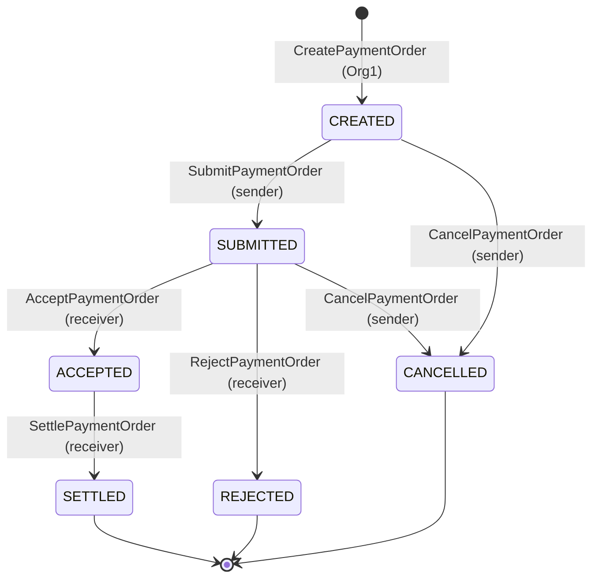

# Спецификация chaincode `payment` v1.0 (Вариант 1 «Банковские операции»)

| Параметр | Значение |
|---|---|
| Имя / версия / sequence | `payment` / `1.0` / `1` |
| Язык, API | Go, `fabric-contract-api-go/v2` v2.2.0, `fabric-chaincode-go/v2` v2.0.0 |
| Канал | `paymentchannel` |
| Endorsement Policy | `AND('Org1MSP.peer','Org2MSP.peer')` |
| Бизнес-объект | `PaymentOrder` — платёжное поручение |
| Org1MSP | Банк-отправитель (Sender Bank) — создаёт и авторизует поручения |
| Org2MSP | Банк-получатель (Receiver Bank) — принимает, отклоняет, исполняет |

## 1. Модель данных

Ключ World State — ID поручения (`PO-...`), значение — JSON. Имена JSON-полей зафиксированы: в v2.0 (Задание 3) их запрещено переименовывать или менять тип.

| Поле JSON | Тип | Правило |
|---|---|---|
| `docType` | string | всегда `PaymentOrder` |
| `id` | string | `^PO-[A-Z0-9-]{4,32}$` |
| `senderBankMSP` | string | MSP вызывающего при создании (= `Org1MSP`) |
| `receiverBankMSP` | string | белый список `{Org1MSP, Org2MSP}`, ≠ sender |
| `amount` | int64 | в минимальных единицах (тиын), `1..100 000 000 000 000`; строгий парсинг, без float |
| `currency` | string | ISO 4217, белый список `KZT, USD, EUR, RUB, CNY` |
| `purposeCode` | string | КНП, `^[0-9]{3}$` |
| `reference` | string | назначение платежа, 1..140 рун, валидный UTF-8, без управляющих символов |
| `status` | string | `CREATED / SUBMITTED / ACCEPTED / REJECTED / SETTLED / CANCELLED` |
| `rejectReason` | string, omitempty | `^[A-Z0-9_]{2,32}$` |
| `createdByHash` | string | `sha256(cid.GetID())` — без персональных данных сотрудника |
| `createdAt`, `updatedAt` | string | `stub.GetTxTimestamp()` в RFC 3339 (детерминированно) |
| `lastTxId` | string | TxID последнего изменения |

Расчётных реквизитов (IBAN, BIC, БИН) в v1.0 **нет** — они появляются только в `paymentsecure` (Задание 2) в private data collection.

## 2. Функции

| Функция | Тип | Кто вправе | Переход | Требование задания |
|---|---|---|---|---|
| `CreatePaymentOrder(id, receiverBankMSP, amount, currency, purposeCode, reference)` | submit | Org1MSP | ∅ → CREATED | создание объекта |
| `ReadPaymentOrder(id)` | evaluate | члены канала | — | чтение |
| `SubmitPaymentOrder(id)` | submit | MSP == senderBankMSP | CREATED → SUBMITTED | изменение состояния |
| `AcceptPaymentOrder(id)` | submit | MSP == receiverBankMSP | SUBMITTED → ACCEPTED | изменение состояния |
| `RejectPaymentOrder(id, reasonCode)` | submit | MSP == receiverBankMSP | SUBMITTED → REJECTED | изменение состояния |
| `SettlePaymentOrder(id)` | submit | MSP == receiverBankMSP | ACCEPTED → SETTLED | **основная бизнес-операция** |
| `CancelPaymentOrder(id)` | submit | MSP == senderBankMSP | CREATED / SUBMITTED → CANCELLED | изменение состояния |
| `PaymentOrderExists(id)` | evaluate | члены канала | — | проверка существования |
| `GetAllPaymentOrders(pageSize, bookmark)` | evaluate | члены канала | — | список (пагинация, `pageSize` 1..50) |
| `GetPaymentOrderHistory(id)` | evaluate | члены канала | — | история ключа (`GetHistoryForKey`) |

## 3. Матрица авторизации

| Операция \ вызывающий | Org1MSP (отправитель) | Org2MSP (получатель) |
|---|---|---|
| Create | ✅ | ❌ `ERR_UNAUTHORIZED` |
| Submit / Cancel | ✅ (если = senderBankMSP) | ❌ `ERR_UNAUTHORIZED` |
| Accept / Reject / Settle | ❌ `ERR_UNAUTHORIZED` | ✅ (если = receiverBankMSP) |
| Read / Exists / List / History | ✅ | ✅ |

## 4. Диаграмма состояний

Таблица переходов — единственный источник истины (`allowedTransitions(from)` в `chaincode/model.go`); любой другой переход → `ERR_INVALID_TRANSITION`.

## 5. Инварианты

| ID | Инвариант | Где обеспечивается |
|---|---|---|
| I-1 | ID уникален | `CreatePaymentOrder` → `ERR_ALREADY_EXISTS` |
| I-2 | `senderBankMSP` = MSP создателя = Org1MSP | `CreatePaymentOrder` |
| I-3 | `amount`, `currency`, `senderBankMSP`, `receiverBankMSP` неизменяемы | ни одна функция их не записывает после создания |
| I-4 | Переходы только по таблице, SETTLED / REJECTED / CANCELLED терминальны | `transition()` |
| I-5 | Исполнение (SETTLED) только из ACCEPTED и только банком-получателем | `SettlePaymentOrder` |
| I-6 | Детерминизм: время — только `GetTxTimestamp`, нет rand/горутин/сети | `scripts/check_determinism.sh` |

## 6. Коды ошибок

`ERR_VALIDATION`, `ERR_UNAUTHORIZED`, `ERR_NOT_FOUND`, `ERR_ALREADY_EXISTS`, `ERR_INVALID_TRANSITION`, `ERR_INTERNAL`. Тексты ошибок не раскрывают внутреннее состояние сверх необходимого (например, при отказе в доступе не сообщается, какой MSP был бы допустим).

## 7. События

`PaymentOrderCreated`, `PaymentOrderSettled` (а также события остальных переходов) с payload `{"id","status","txId"}` — без сумм и реквизитов.

## 8. OWASP SC Top 10 (2025) в коде v1.0

Защитные решения помечены комментариями `// OWASP SCxx:2025 — ...`. Подробный маппинг — `docs/security/owasp-sc-baseline-v1.md`.
