## 1. Цель работы и описание предметной области

**Цель работы** — получить практические навыки проектирования корпоративной блокчейн-сети Hyperledger Fabric, разработки chaincode, управления идентификацией и конфиденциальностью, анализа угроз, проверки бизнес-логики, а также безопасного обновления chaincode и компонентов сети.

**Вариант 1 — «Банковские операции».** Два банка обмениваются платёжными поручениями через общий permissioned-реестр:

| Роль | Организация | MSP ID | Что делает |
|---|---|---|---|
| Банк-отправитель (Sender Bank) | Org1 | `Org1MSP` | создаёт платёжное поручение, вводит расчётные реквизиты, авторизует списание |
| Банк-получатель (Receiver Bank) | Org2 | `Org2MSP` | принимает или отклоняет поручение, исполняет (зачисляет) платёж |
| Ordering Service | OrdererOrg | `OrdererMSP` | упорядочивает транзакции и формирует блоки |

**Бизнес-объект** — `PaymentOrder` (платёжное поручение) с жизненным циклом `CREATED → SUBMITTED → ACCEPTED → SETTLED` (а также `REJECTED`, `CANCELLED`; в версии 2.0 — `RETURNED`). **Конфиденциальные данные** — расчётные реквизиты (IBAN плательщика и получателя, BIC, БИН/ИИН, наименование получателя): их видит только банк-отправитель, банк-получатель может лишь сверить хэш.

**Почему permissioned-реестр и AND-политика.** Межбанковский платёж — совместный процесс двух юридически независимых сторон, ни одна из которых не должна единолично управлять общей записью. Fabric даёт идентифицированных участников (X.509 от Fabric CA), неизменяемый журнал операций и политику подтверждения `AND('Org1MSP.peer','Org2MSP.peer')`: результат каждой транзакции должны подписать peers **обоих** банков, поэтому ни один банк не может записать в реестр результат, не воспроизводимый у другой стороны.

**Среда выполнения:** Windows 11 + WSL2 (Ubuntu 24.04.5 LTS), Docker Engine 29.8.2 (Docker Desktop), Docker Compose v5.6.0, Go 1.27.2 (хост) / Go 1.26.4 (образ `fabric-ccenv:3.1.5`), **Hyperledger Fabric 3.1.5**, **Fabric CA 1.5.22** — последние patch-версии, определённые через GitHub Releases API (`evidence/task1/01_versions.log`).

## 2. Архитектура сети

### 2.1. Создание сети (задание 1.1)

Сеть создана на базе `fabric-samples/test-network` командой `./network.sh up createChannel -c paymentchannel -ca -s couchdb` (`scripts/02_network_up.sh`): идентичности выпускает **Fabric CA** (`-ca`), World State хранится в **CouchDB** (`-s couchdb`). Результат — 2 организации, 2 peer, Raft-orderer, 3 Fabric CA, 2 CouchDB, канал `paymentchannel` (`evidence/task1/02_network_up.log`, 11 проверок ✔).

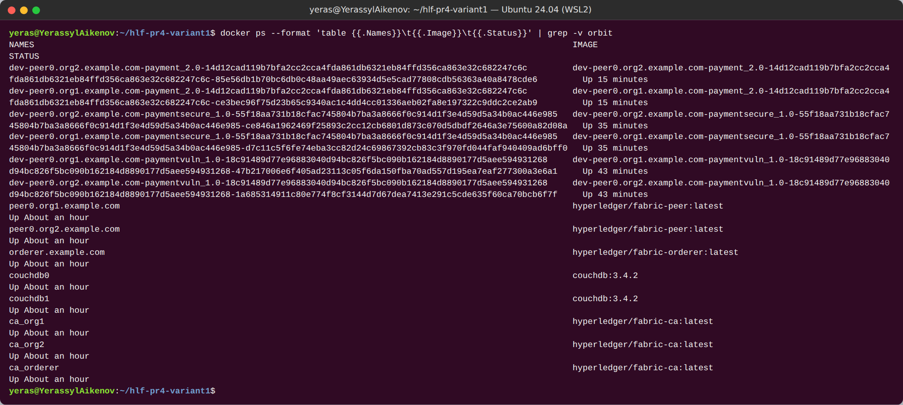

*Рисунок 1 — Контейнеры сети: peer0.org1/peer0.org2, orderer, ca_org1/ca_org2/ca_orderer, couchdb0/couchdb1, контейнеры chaincode*

### 2.2. Архитектурная схема (задание 1.3)

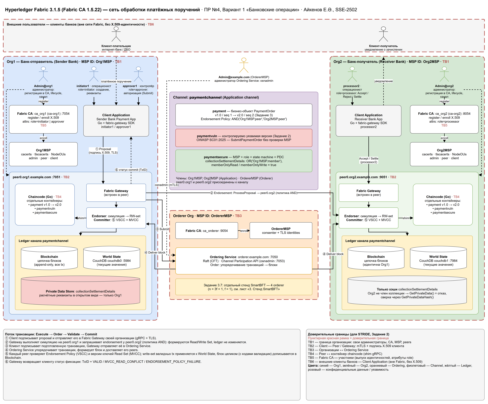

*Рисунок 2 — Архитектура сети с доверительными границами TB1–TB6 (`docs/architecture/architecture_variant1.drawio`, лист 1). Схема сверена с реальной сетью: имена контейнеров, порты, имена CA и CouchDB совпадают.*

| Компонент | Контейнер | Порт | MSP | Роль в варианте 1 |
|---|---|---|---|---|
| Peer + Fabric Gateway | `peer0.org1.example.com` | 7051 | Org1MSP | endorser/committer банка-отправителя, Gateway для Sender Bank App |
| Peer + Fabric Gateway | `peer0.org2.example.com` | 9051 | Org2MSP | endorser/committer банка-получателя |
| Ordering Service (Raft) | `orderer.example.com` | 7050, admin 7053 | OrdererMSP | упорядочивание, блоки, Channel Participation API |
| Fabric CA | `ca_org1` / `ca_org2` / `ca_orderer` | 7054 / 8054 / 9054 | Org1MSP / Org2MSP / OrdererMSP | X.509, атрибут `role` |
| World State | `couchdb0` / `couchdb1` (CouchDB 3.4.2) | 5984 / 7984 | — | текущие значения ключей; private data только у Org1 |
| Chaincode | `dev-peer0.orgN…-payment_*` | — | — | бизнес-логика PaymentOrder |
| Client Application | `client/payment-client` (Go, fabric-gateway 1.10.0) | — | Org1MSP/Org2MSP | Submit/Evaluate через Gateway |
| Channel / Ledger | `paymentchannel` | — | Org1MSP, Org2MSP, OrdererMSP | общий Blockchain + World State каждого peer |

Поток транзакции ①–⑥ (Execute → Order → Validate → Commit): ① клиент подписывает proposal и отправляет в Gateway своей организации (gRPC+TLS); ② Gateway выполняет симуляцию на peer0.org1 и запрашивает endorsement у peer0.org2 (политика AND), формируются Read/Write Set; ③ клиент подписывает транзакцию, Gateway передаёт её в Ordering Service; ④ orderer упорядочивает транзакции и доставляет блок peers; ⑤ каждый peer проверяет Endorsement Policy (VSCC) и версии ключей (MVCC), применяет write-set валидных транзакций к World State и дописывает блок целиком; ⑥ клиент получает статус фиксации (TxID + код валидации).

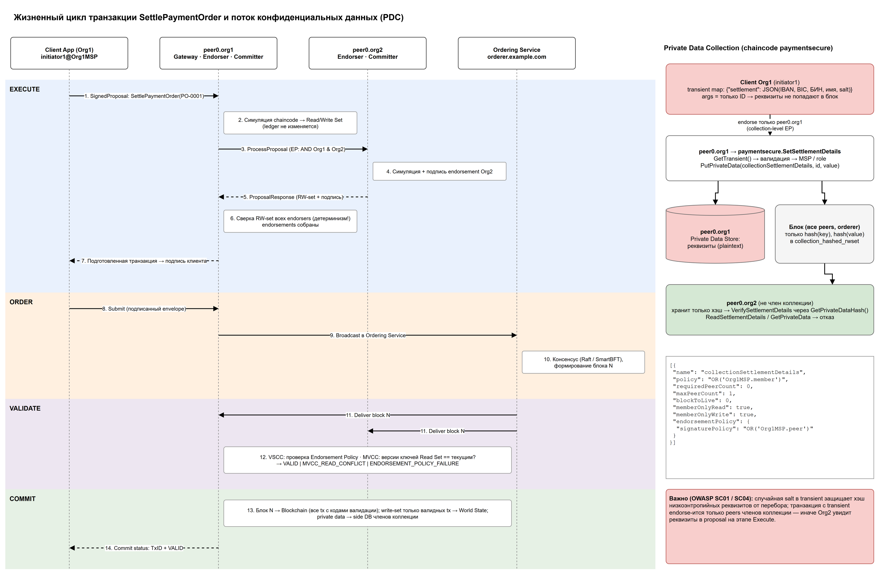

*Рисунок 3 — Поток Execute → Order → Validate → Commit и путь private data (лист 2 схемы)*

### 2.3. CLI-окружение и административная идентичность Org1 (задание 1.2)

`scripts/env_org1.sh` / `env_org2.sh` (через `source`) повторяют `test-network/scripts/envVar.sh`: `PATH`, `FABRIC_CFG_PATH`, `CORE_PEER_TLS_ENABLED=true`, `CORE_PEER_LOCALMSPID`, `CORE_PEER_TLS_ROOTCERT_FILE`, `CORE_PEER_MSPCONFIGPATH` (Admin@org1.example.com), `CORE_PEER_ADDRESS`, `ORDERER_CA`, TLS-корни обоих peers; переменная `ORG_USER` переключает пользователя. Доказательство (`evidence/task1/04_cli_env_org1.log`, 7 ✔): `peer channel list` и `peer channel getinfo` (работа с Peer); `peer channel fetch config` — получен конфигурационный блок №2 от Ordering Service; идентичность администратора: `subject=… OU = admin, CN = org1admin`, `issuer=… CN = ca.org1.example.com`, NodeOUs включены (`AdminOUIdentifier = admin`). Ключ и PEM в отчёт не выводятся.

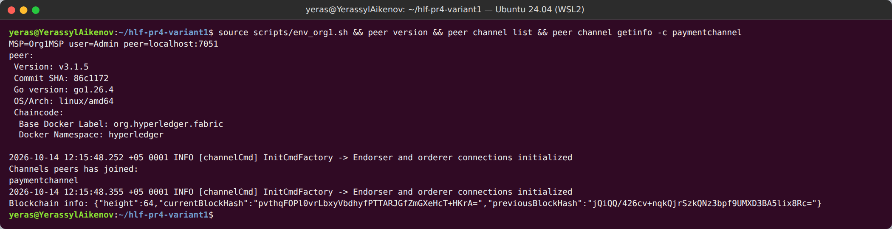

*Рисунок 4 — CLI-окружение Org1 Admin: версия peer 3.1.5, канал paymentchannel*

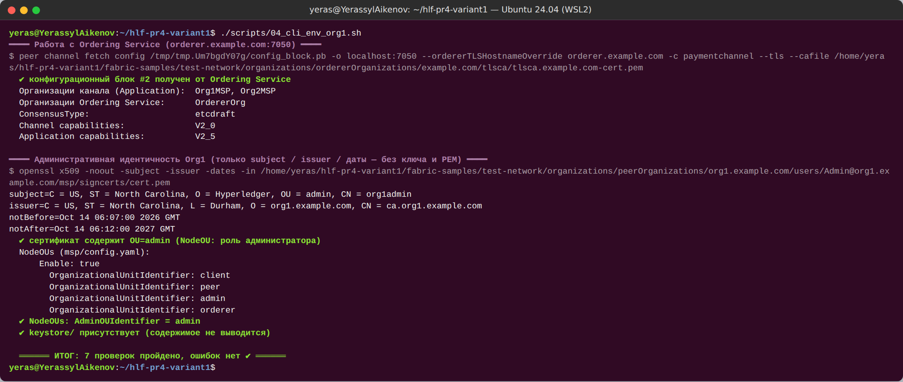

*Рисунок 5 — Получение конфигурации канала от Ordering Service, параметры канала (etcdraft, capabilities V2_0 / V2_5) и subject/issuer сертификата Admin@org1*

## 3. Chaincode, Endorsement Policy и транзакции

### 3.1. Chaincode `payment` v1.0

Go, `fabric-contract-api-go/v2` v2.2.0 (`chaincode/payment-v1`), спецификация — `docs/chaincode/payment-v1-spec.md`.

| Функция | Тип | Кто вправе | Переход | Требование задания |
|---|---|---|---|---|
| `CreatePaymentOrder(id, receiverBankMSP, amount, currency, purposeCode, reference)` | submit | Org1MSP | ∅ → CREATED | создание объекта |
| `ReadPaymentOrder(id)` | evaluate | члены канала | — | чтение |
| `SubmitPaymentOrder(id)` | submit | MSP = senderBankMSP | CREATED → SUBMITTED | изменение состояния |
| `AcceptPaymentOrder(id)` | submit | MSP = receiverBankMSP | SUBMITTED → ACCEPTED | изменение состояния |
| `RejectPaymentOrder(id, reasonCode)` | submit | MSP = receiverBankMSP | SUBMITTED → REJECTED | изменение состояния |
| `SettlePaymentOrder(id)` | submit | MSP = receiverBankMSP | ACCEPTED → SETTLED | **основная бизнес-операция** |
| `CancelPaymentOrder(id)` | submit | MSP = senderBankMSP | CREATED / SUBMITTED → CANCELLED | изменение состояния |
| `PaymentOrderExists(id)` | evaluate | члены канала | — | проверка существования |
| `GetAllPaymentOrders(pageSize, bookmark)` | evaluate | члены канала | — | список (пагинация 1..50) |
| `GetPaymentOrderHistory(id)` | evaluate | члены канала | — | история ключа |

Матрица авторизации: Org1MSP — Create, Submit, Cancel; Org2MSP — Accept, Reject, Settle; оба — чтение. Таблица допустимых переходов — единственный источник истины (`allowedTransitions()`), любой другой переход → `ERR_INVALID_TRANSITION`; SETTLED, REJECTED, CANCELLED — терминальные.

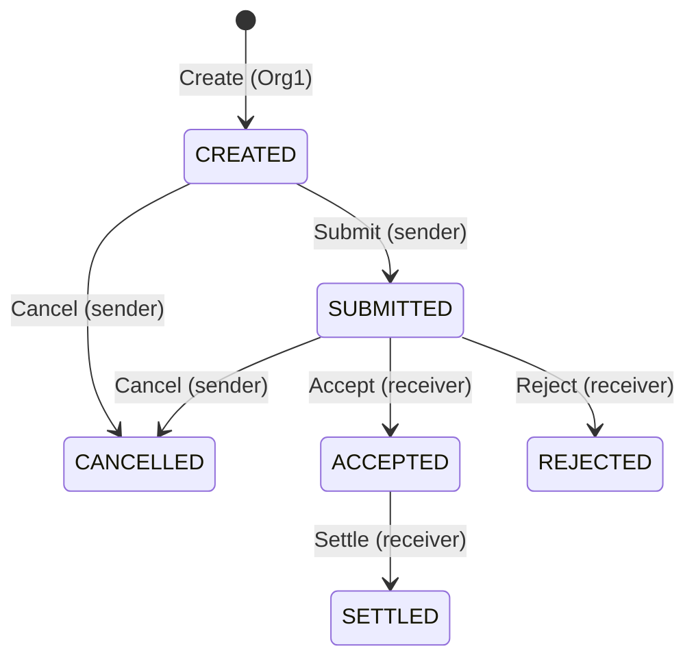

**Валидация входных данных** (OWASP SC04/SC08): ID `^PO-[A-Z0-9-]{4,32}$`; сумма — целое в тиынах, regex без знака/экспоненты/ведущих нулей + `strconv.ParseInt` + верхняя граница 10¹⁴; валюта из белого списка ISO 4217; КНП — 3 цифры; назначение платежа ≤ 140 символов, валидный UTF-8 без управляющих символов. Время — только `GetTxTimestamp` (детерминизм), идентичность создателя хранится как `sha256(GetID())`.

**Тесты и анализ** (`evidence/task1/07_static_analysis.log`): 70 unit-тестов (counterfeiter-моки + in-memory ledger; каждый из 24 недопустимых переходов, каждая функция от «чужого» MSP, 26 табличных тестов валидации), покрытие **97.0 %**; `go vet`, `staticcheck`, `gosec`, `govulncheck` — 0 находок; `check_determinism.sh` — 0 находок.

**Найденный при первом деплое дефект.** Первая попытка транзакций (`evidence/task1/attempt1/`) завершилась отказом endorsement: `value did not match schema: rejectReason is required`. `contractapi` валидирует возвращаемые значения по сгенерированной JSON-схеме и считает поле с `omitempty` обязательным, если оно не помечено `metadata:",optional"`. Unit-тесты, вызывающие методы напрямую, этого не видели. Исправлено тегом, добавлен регрессионный тест через `ContractChaincode.Invoke` (тот же путь, что у peer), проверено, что без тега тест падает с тем же сообщением. Так как исправленный код — новый пакет, сеть была пересоздана **до** получения каких-либо доказательств, чтобы основной chaincode имел ровно version 1.0 / sequence 1.

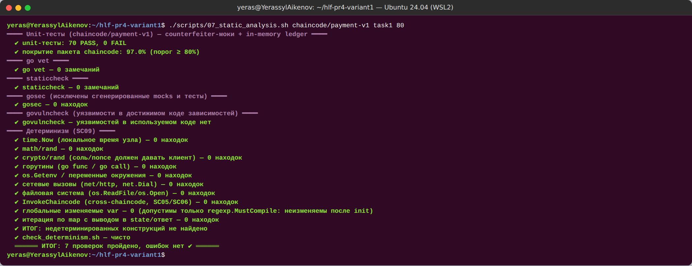

*Рисунок 6 — Unit-тесты, покрытие и статический анализ chaincode payment v1.0*

### 3.2. Развёртывание: version 1.0, sequence 1, политика AND (задание 1.4)

`scripts/lifecycle.sh` — явный жизненный цикл без `network.sh deployCC`: `go mod vendor` → `peer lifecycle chaincode package` → `calculatepackageid` → `install` на peer0.org1 и peer0.org2 → `approveformyorg` Org1 → `checkcommitreadiness` (`Org1MSP: true, Org2MSP: false`) → `approveformyorg` Org2 → `checkcommitreadiness` (`true / true`) → `commit` с обоими peers → `querycommitted`. Флаг `--signature-policy "AND('Org1MSP.peer','Org2MSP.peer')"` передавался идентично во все команды.

- **Package ID:** `payment_1.0:41e4157887f433f851ad7fcb43f449aff92a55a8a0f855676c5319d3e6769748`
- `querycommitted`: `"sequence": 1, "version": "1.0"`, `approvals: {Org1MSP: true, Org2MSP: true}`, `validation_parameter` декодирован как ApplicationPolicy: **2-out-of-2 [Org1MSP, Org2MSP], role PEER** = `AND('Org1MSP.peer','Org2MSP.peer')`.

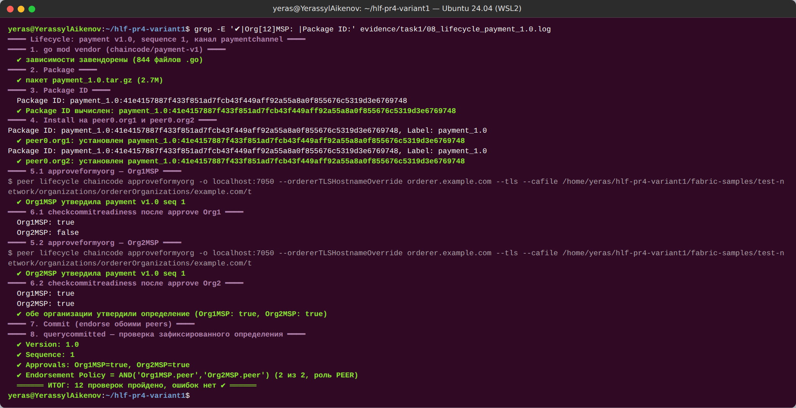

*Рисунок 7 — Package ID, установка на оба peers, переход readiness Org2MSP false → true*

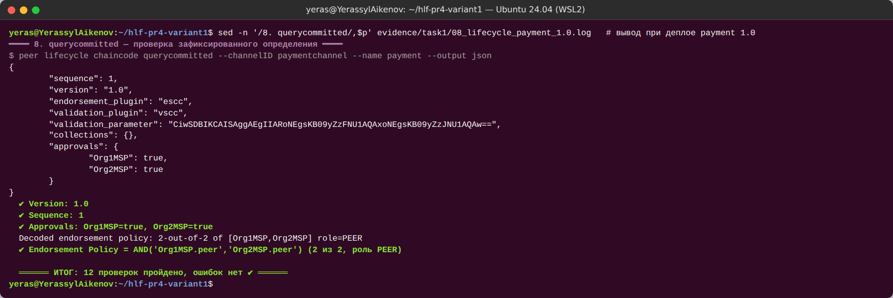

*Рисунок 8 — Зафиксированное определение: Version 1.0, Sequence 1, политика AND, approvals обеих организаций*

### 3.3. Транзакции с TxID (задание 1.5)

`scripts/10_transactions.sh`; номер блока и код валидации определены из реального блока (`qscc GetBlockByTxID` → `configtxlator`), а не по догадке. Полный список — `evidence/task1/txids.csv`.

| # | Операция | От имени | TxID | Блок | Код |
|---|---|---|---|---|---|
| T1 | Create PO-0001 (5 000 000 тиын, KZT, КНП 119) | Org1MSP/Admin | `d0f75e8f6802ce2586074840bc9edf3d0a1d2189e90dcab9818c0ba3cf7ea78a` | 6 | VALID |
| T2 | Submit PO-0001 | Org1MSP/Admin | `8c9b636187e5b29c4788548ee13c1eb0bd39b941218fb26f652d3a9bf062c681` | 7 | VALID |
| T3 | Accept PO-0001 | Org2MSP/Admin | `bad5e7d6484c37429c8b0ff1368739a07300724fee5e3dea7843c0675c217ce6` | 8 | VALID |
| T4 | **Settle PO-0001** — основная бизнес-операция | Org2MSP/Admin | `6d535b17ed87353864ed5766a39ab25b8937223d857c2c80b5b81b7ba4e489ea` | 9 | VALID |
| T5 | Create PO-0002 **через Fabric Gateway** (Go-клиент) | Org1MSP/Admin | `69f6d6bd56354453d50261bf486f6fe82ecadedd6df9b923842269d8b2e501ce` | 10 | VALID |
| T6 | Cancel PO-0002 | Org1MSP/Admin | `499123ba236b5ac0e2f552f3b74a0a919fd259edff225698f0406ac8054f36ba` | 11 | VALID |
| T7 | Create PO-0003 (остаётся CREATED для Задания 3) | Org1MSP/Admin | `43dd8a91382e11845a39f520b66714bbbcccedccc91cec4eabbf278e801bec67` | 12 | VALID |
| N1 | Settle PO-0003 из CREATED | Org2MSP/Admin | — | — | отказ при endorsement: `ERR_INVALID_TRANSITION: transition CREATED -> SETTLED is not allowed` |
| N2 | Create PO-0004 от Org2 | Org2MSP/Admin | — | — | отказ: `ERR_UNAUTHORIZED: caller organisation may not create payment orders` |
| T8 | Create PO-0005 (MVCC-демо) | Org1MSP/Admin | `d949c0a625223cd7a90bedd4e0fb11c3bf8c90822cd14ba55e4074284a4250d0` | 13 | VALID |
| M2 | Cancel PO-0005 (параллельно с M1) | Org1MSP/Admin | `0fadf26417fdb06941482a121da4b3e6a5b29123a2fb1a9e55ba77cb6f3026b3` | 14 | VALID |
| M1 | Submit PO-0005 (параллельно с M2) | Org1MSP/Admin | `9f45207008f0416c6cc665bf14adbfd5e3b420c9caf4412fe0f330ca1c889de2` | 14 | **MVCC_READ_CONFLICT** |

Итого 9 VALID-транзакций (требуется ≥ 4), одна — через Gateway-клиент. N1 и N2 отклонены на этапе Execute и в ledger не попали. **MVCC-демо:** Submit и Cancel одного ключа отправлены параллельно, оба endorse-ились по одной версии ключа, упорядочены в один блок 14; валидатор принял первую (Cancel) и пометил вторую `MVCC_READ_CONFLICT` — её write-set не применён, но транзакция хранится в блоке.

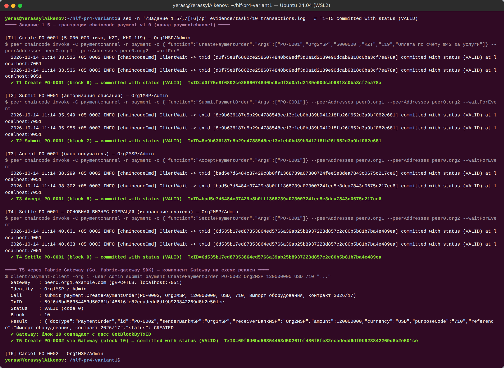

*Рисунок 9 — Транзакции T1–T4 через peer CLI и T5 через Fabric Gateway; TxID и блоки*

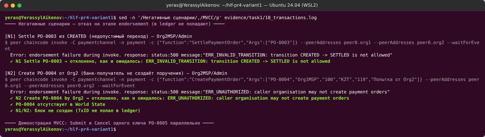

*Рисунок 10 — Недопустимый переход (N1) и создание поручения банком-получателем (N2) отклонены chaincode*

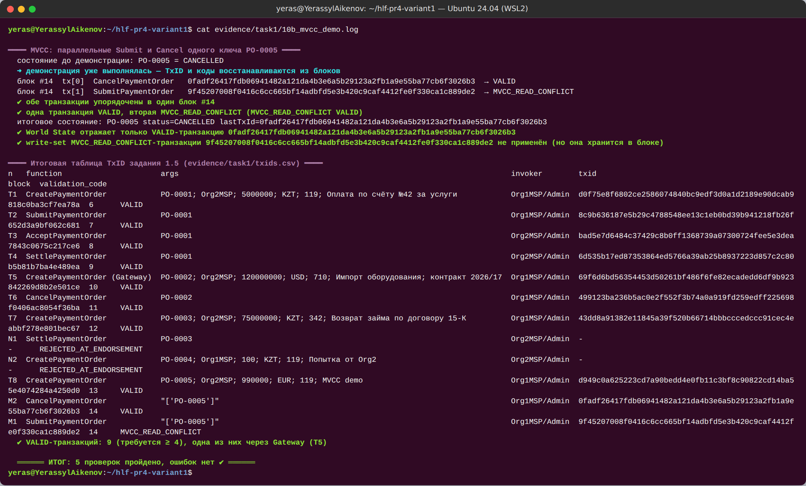

*Рисунок 11 — Две параллельные транзакции над PO-0005 в одном блоке: VALID и MVCC_READ_CONFLICT*

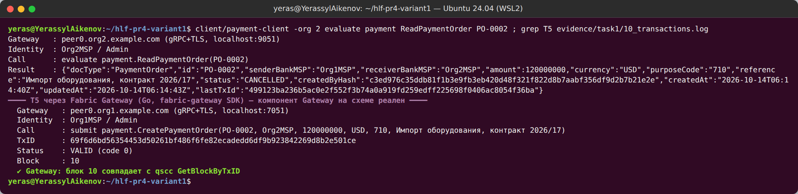

*Рисунок 12 — Клиентское приложение на Fabric Gateway (Org2 читает PO-0002; T5 — запись через Gateway)*

### 3.4. Разбор транзакции T4 по этапам

`scripts/analyze_tx.sh` → `evidence/task1/tx_anatomy_6d535b17….md`. Все значения взяты из реального блока 9.

| Этап | Данные из блока |
|---|---|
| **Proposal** | тип 3 `ENDORSER_TRANSACTION`, канал `paymentchannel`, chaincode `payment`, функция `SettlePaymentOrder(PO-0001)` (аргументы декодированы из base64), создатель **Org2MSP** (`CN = org2admin`), timestamp `2026-10-14T06:14:38.531737903Z`. **TxID = SHA-256(nonce ‖ creator)** — пересчитан скриптом и совпал с tx_id; поэтому клиент не выбирает TxID произвольно, а повтор отклоняется как `DUPLICATE_TXID`. |
| **Endorsement** | endorsers **Org2MSP, Org1MSP**, 2 подписи (сами подписи не приводятся), ответ chaincode status 200, версия chaincode 1.0, событие `PaymentOrderSettled` (payload без сумм). Read Set: `PO-0001` версии **8/0** (блок 8, транзакция 0 — запись T3). Write Set: `PO-0001`, 466 байт, `status=SETTLED`. |
| **Ordering** | блок **9**, позиция 0 из 1, `data_hash = 0qMqflTmkjURsQu3lxltEjSYiOUMPgsscgabTfsLBTg=`, `previous_hash = j5qeguIDDQMnvNiKRekb2LB4g9SO7ZXTTLnR7pUBRaw=`, подпись orderer в metadata[SIGNATURES] — **OrdererMSP** (`OU = orderer, CN = orderer`). |
| **Validation** | `TRANSACTIONS_FILTER[0] = 0 (VALID)`: VSCC — подписи Org1MSP и Org2MSP удовлетворяют AND; MVCC — версия 8/0 совпала с World State. |
| **Commit** | лог peer0.org1: `Committed block [9] with 1 transaction(s) … commitHash=[9c4535…19ae]` (то же на peer0.org2); `ReadPaymentOrder(PO-0001)` → SETTLED, `GetPaymentOrderHistory` содержит этот TxID. |

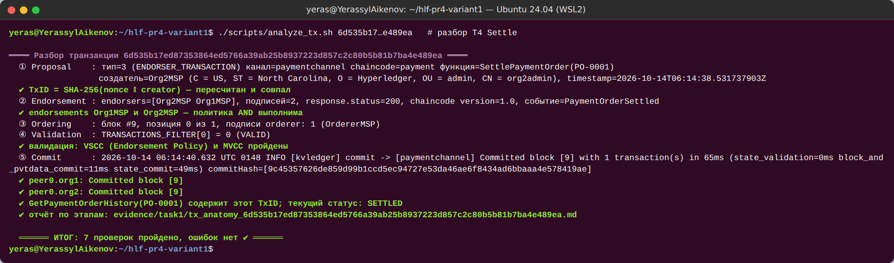

*Рисунок 13 — Разбор транзакции T4 Settle по этапам Proposal → Endorsement → Ordering → Validation → Commit*

### 3.5. Состояние бизнес-объектов (задание 1.6)

| Объект | Ожидаемый статус | Фактический | Сумма | lastTxId |
|---|---|---|---|---|
| PO-0001 | SETTLED | SETTLED ✅ | 5 000 000 KZT | `6d535b17…e489ea` (T4) |
| PO-0002 | CANCELLED | CANCELLED ✅ | 120 000 000 USD | `499123ba…f36ba` (T6) |
| PO-0003 | CREATED | CREATED ✅ | 75 000 000 KZT | `43dd8a91…bec67` (T7) |
| PO-0005 | SUBMITTED или CANCELLED | CANCELLED ✅ | 990 000 EUR | `0fadf264…026b3` (M2) |

`GetAllPaymentOrders` с `pageSize = 2` вернул 4 объекта на 2 страницах (bookmark `PO-0003`); `pageSize = 51` отклонён (SC10). `GetPaymentOrderHistory(PO-0001)` содержит все четыре TxID T1–T4. В CouchDB (`paymentchannel_payment` на couchdb0) документ PO-0001 хранится со служебным полем `~version = "CgMBCQA="` — это закодированная версия ключа (блок 9, транзакция 0), используемая MVCC. Учётные данные CouchDB в лог не попадали (`evidence/task1/12_state.log`, 12 ✔).

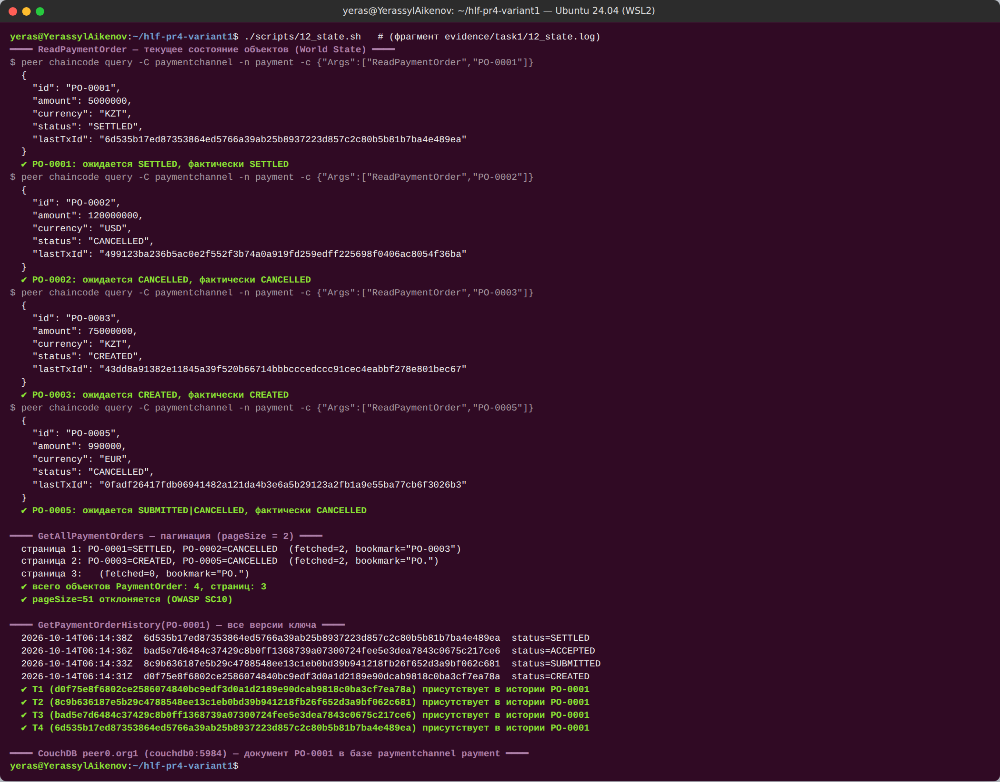

*Рисунок 14 — ReadPaymentOrder, пагинация и история PO-0001 (T1–T4)*

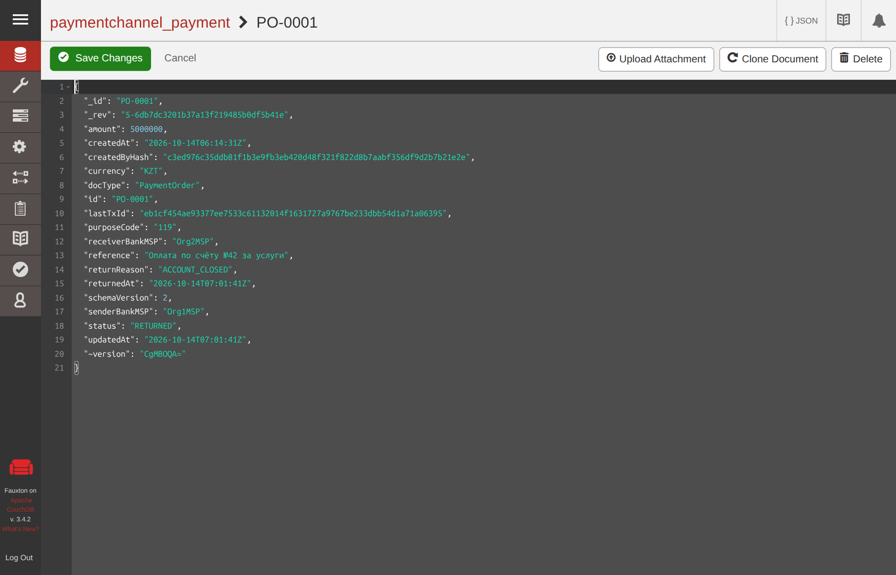

*Рисунок 15 — Документ PO-0001 в CouchDB peer0.org1 (Fauxton; снимок сделан после Задания 3, поэтому статус RETURNED и schemaVersion 2; пароль на экране отсутствует)*

### 3.6. Исследование Ledger (задание 1.7)

`scripts/13_ledger_info.sh` (`evidence/task1/13_ledger_info.log`, 10 ✔), на момент исследования:

- **Высота** канала — **15** (блоки 0..14), `currentBlockHash = 7+KqMIh3IKXgeMZ1ci6YCLq54Wqg4FcIYEio+N3bCT4=`, `previousBlockHash = SM2MJEjETB/tqhLuPxA5mPwGmWaoXtZA+SZGdv+cxEE=`.
- **Последний блок №14**: `data_hash = vQMdrxR+7qdm6Mz/FxhyyRFjeV7Q+Eo5Xl+ny9iHTAQ=`, 2 транзакции — `0fadf264…` VALID и `9f452070…` MVCC_READ_CONFLICT.
- **Связность:** `previous_hash` блока 14 = `previousBlockHash` из getinfo; хэш заголовка, пересчитанный локально как SHA-256(ASN.1(number, previous_hash, data_hash)), совпал с `currentBlockHash`; хэш заголовка блока 13 записан в `previous_hash` блока 14; пройдена вся цепочка 0..14 — разрывов нет.
- Наблюдение: копия блока, полученная от orderer (`peer channel fetch`), **не содержит** `TRANSACTIONS_FILTER`, а копия из ledger peer (`qscc GetBlockByNumber`) — содержит; заголовки идентичны. Это прямое подтверждение того, что валидацию выполняет peer, а не orderer.
- **Блок 0** — конфигурационная транзакция (тип 1 CONFIG): организации Application `Org1MSP, Org2MSP`, Orderer `OrdererOrg`, MSP с NodeOUs, политики `Admins/Readers/Writers`, `LifecycleEndorsement = MAJORITY Endorsement`, capabilities Channel `V2_0`, Application `V2_5`, Orderer `V2_0`, `ConsensusType = etcdraft`, BatchSize 10 сообщений / BatchTimeout 2 s.

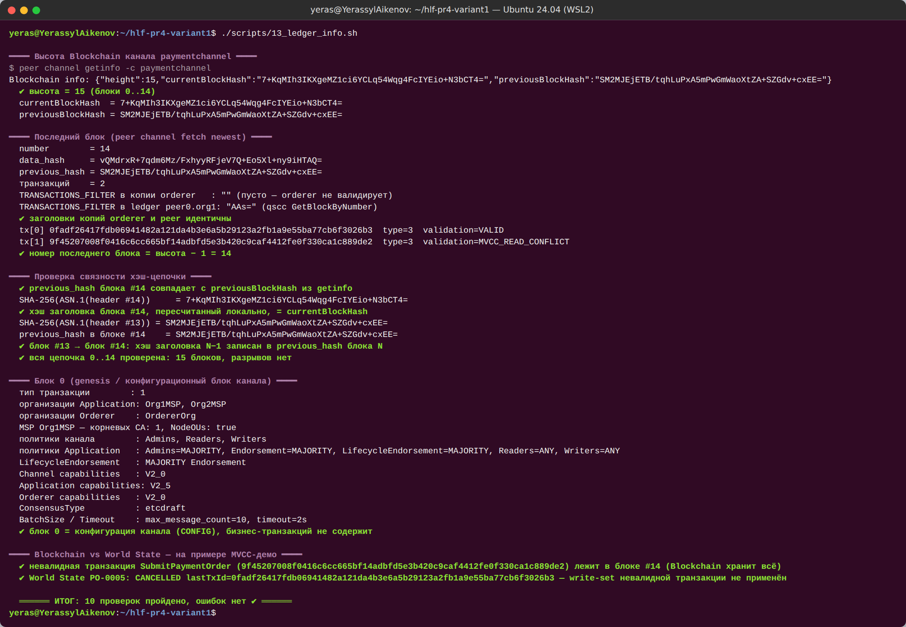

*Рисунок 16 — Высота, последний блок, проверка хэш-цепочки и состав блока 0*

**Blockchain vs World State.** *Blockchain* — неизменяемый журнал **всех** упорядоченных транзакций, включая невалидные: транзакция M1 с `MVCC_READ_CONFLICT` лежит в блоке 14. *World State* (CouchDB) — текущие значения ключей, производная от Blockchain: в нём PO-0005 = CANCELLED с `lastTxId` транзакции M2, write-set M1 не применён. World State можно пересобрать из блоков (`peer node rebuild-dbs`), обратное невозможно. *History DB* — индекс изменений ключа по валидным транзакциям (`GetPaymentOrderHistory`).

### 3.7. Базовый маппинг OWASP SC Top 10 (2025)

Сверено с официальной страницей OWASP (названия SC01–SC10 редакции 2025 совпадают). Подробно — `docs/security/owasp-sc-baseline-v1.md`: SC01 — проверка MSP в каждой изменяющей функции (N2); SC02 — внешних оракулов нет, сумма неизменяема; SC03 — явная state machine (N1); SC04 — строгая валидация; SC05/SC06 — нет `InvokeChaincode`; SC07 — одна транзакция = один переход; SC08 — `ParseInt` + MaxAmount, без float; SC09 — `GetTxTimestamp`, `check_determinism.sh`; SC10 — пагинация с потолком 50, лимиты длины.
