## 6. Обновление chaincode 1.0 → 2.0 (sequence 1 → 2)

### 6.1. Исходное состояние (задание 3.1)

`scripts/30_pre_upgrade_snapshot.sh` → `evidence/task3/30_pre_upgrade/` (11 ✔): `querycommitted` — **Version 1.0, Sequence 1**, политика AND, approvals обеих организаций; Package ID на обоих peers `payment_1.0:41e4157887f433f851ad7fcb43f449aff92a55a8a0f855676c5319d3e6769748`; состояние объектов: PO-0001 SETTLED, PO-0002 CANCELLED, PO-0003 CREATED; полный снимок `GetAllPaymentOrders` → `state_v1.json` (ключи упорядочены `jq -S`), **sha256 `69f0ea3b7778c52a39e44802cca560a0d3839253af992d9da08f9e4b5bf7e480`**; высота канала до обновления — 51. Реальный JSON PO-0001 и PO-0003 сохранён как golden-фикстуры для unit-тестов v2.0.

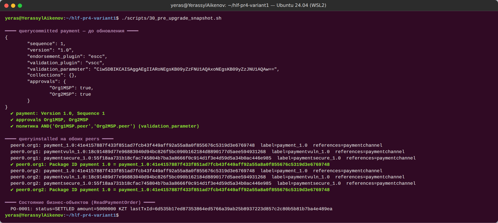

*Рисунок 29 — Исходное состояние: payment 1.0 / 1, Package ID, статусы объектов*

### 6.2. Chaincode 2.0 и совместимость с World State (задание 3.2)

`chaincode/payment-v2` — эволюция v1.0 (тот же namespace `payment`). Правила совместимости (`docs/upgrade/payment-v2-compat.md`): (1) формат ключей `PO-…` не меняется; (2) JSON-поля v1.0 не переименовываются, не удаляются, не меняют тип; (3) новые поля только `omitempty` + `metadata:",optional"`; (4) **ленивая миграция** — объект без `schemaVersion` читается как версия 1, первая запись через v2.0 ставит `schemaVersion: 2`, массовой миграции в `Init` и `--init-required` нет; (5) статусы и переходы только добавляются; (6) сигнатуры функций v1.0 не меняются.

Новая функциональность: `ReturnPaymentOrder(id, reasonCode)` — возврат исполненного платежа банком-получателем (SETTLED → **RETURNED**, терминальный, не более одного раза); `SetValueDate(id, date)` — дата валютирования (только отправитель, только CREATED; сигнатура Create не меняется); `GetPaymentOrdersByStatus(status, pageSize, bookmark)` — rich query CouchDB по индексу `META-INF/statedb/couchdb/indexes/indexStatus.json`. Новые поля: `schemaVersion`, `valueDate`, `returnReason`, `returnedAt`.

OWASP-ревью обновления (`docs/upgrade/owasp-upgrade-review.md`): SC01 — Return только получатель, SetValueDate только отправитель; SC03 — RETURNED нельзя повторить и нельзя попасть в него в обход SETTLED; SC04 — reasonCode, строгая календарная дата, статус из белого списка, селектор строится `json.Marshal` (инъекция `{"$gt":null}` отклонена); SC09 — rich query только в evaluate, результат не используется для записи (rich queries не перепроверяются на phantom reads); SC10 — pageSize 1..50, индекс.

Тесты: 76 (все 70 тестов v1.0 — файлы скопированы **без изменений** и проходят; golden-фикстуры v1; ленивая миграция; новые функции, включая негативные), покрытие **96.5 %**, `go vet`/`staticcheck`/`gosec`/`govulncheck`/`check_determinism` — 0 находок (`evidence/task3/32_static_analysis_payment_v2.log`).

**Package ID 2.0:** `payment_2.0:14d12cad119b7bfa2cc2cca4fda861db6321eb84ffd356ca863e32c682247c6c`.

### 6.3. Установка, утверждение, commit (задания 3.3–3.5)

| Этап | Результат | Доказательство |
|---|---|---|
| Install на peer0.org1 и peer0.org2 | `queryinstalled` на обоих peers показывает **оба** пакета: `payment_1.0:41e41578…` и `payment_2.0:14d12cad…`. Установка сама по себе ничего не меняет в канале — код исполняется только после commit нового определения | `33_install_payment_2.0.log`, рисунок 30 |
| approveformyorg Org1 → readiness | `Org1MSP: true, Org2MSP: false` | `34_approve_payment_2.0.log` |
| approveformyorg Org2 → readiness | `Org1MSP: true, Org2MSP: true` | рисунок 31 |
| Негатив: approve с `--sequence 3` | `requested sequence 3 is larger than the next available sequence number 2` | `34_negative_lifecycle.log`, рисунок 32 |
| Негатив: readiness с политикой OR / без политики | approvals `false / false` — это другое определение; пропуск `--signature-policy` молча сменил бы модель доверия на политику канала по умолчанию | рисунок 32 |
| Commit (оба peers) → querycommitted | **Version 2.0, Sequence 2**, `validation_parameter` идентичен 1.0 (AND), approvals обеих организаций | `35_commit.log`, рисунок 33 |
| Первое обращение | запущены `dev-peer0.org1/org2…-payment_2.0-14d12cad…`, контейнеры 1.0 остановлены | рисунок 33 |

| Параметр | До | После |
|---|---|---|
| Version | 1.0 | **2.0** |
| Sequence | 1 | **2** |
| Package ID | `payment_1.0:41e41578…9748` | `payment_2.0:14d12cad…7c6c` |
| Endorsement Policy | AND('Org1MSP.peer','Org2MSP.peer') | без изменений |

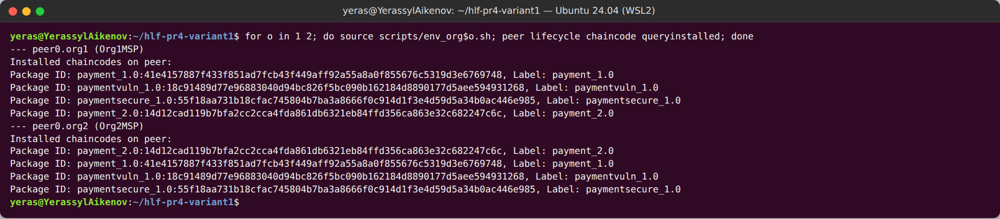

*Рисунок 30 — На каждом peer установлены payment 1.0 и 2.0 (а также paymentvuln, paymentsecure)*

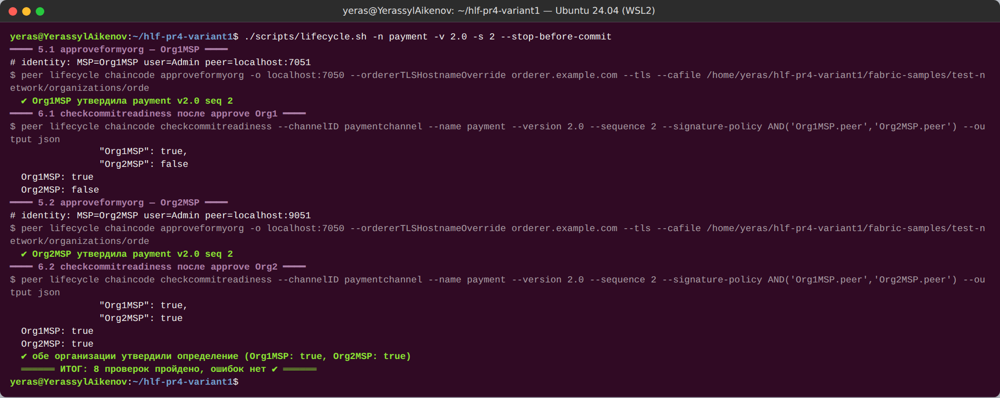

*Рисунок 31 — Утверждение определения 2.0 / 2 организациями*

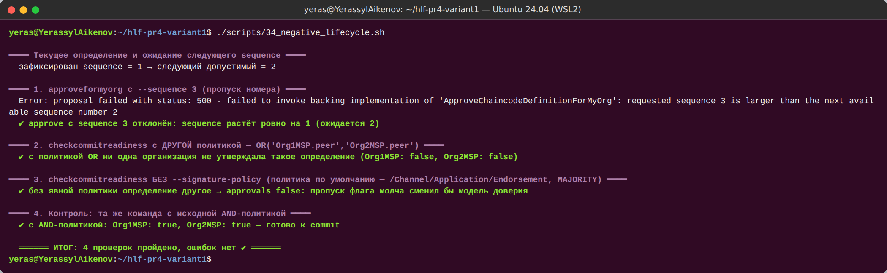

*Рисунок 32 — Отказ при sequence 3 и несовпадение определения при другой политике*

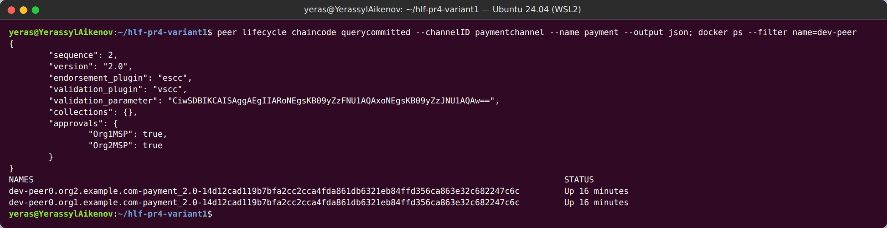

*Рисунок 33 — Version 2.0, Sequence 2; запущены контейнеры payment_2.0*

### 6.4. Проверка обратной совместимости (задание 3.6)

`scripts/36_compat_check.sh` (`evidence/task3/36_compat.log`, 19 ✔, `compat_table.md`):

| Проверка | Действие через v2.0 | Результат | TxID / блок |
|---|---|---|---|
| C1 | `ReadPaymentOrder(PO-0001)`, созданного и исполненного v1.0 | JSON **идентичен** снимку v1 (diff пуст), `schemaVersion` отсутствует → версия 1 | — |
| C2 | `GetAllPaymentOrders` → `state_after.json` | **sha256 = `69f0ea3b…e480`** — совпадает со `state_v1.json` | — |
| C3 | старые операции Submit → Accept → Settle над PO-0003 (создан v1.0) | VALID ×3, после записи `schemaVersion: 2` | `7aeadc74…ef04` (54), `25cd07a4…6127` (55), `bb508e5e…ac39` (56) |
| C4 | новая функция `ReturnPaymentOrder(PO-0001)` | VALID, RETURNED, `returnReason=ACCOUNT_CLOSED` | `eb1cf454ae93377ee7533c61132014f1631727a9767be233dbb54d1a71a06395` (57) |
| C5 | повторный Return PO-0001 | отказ `ERR_INVALID_TRANSITION: RETURNED -> RETURNED` | — |
| C6 | `GetPaymentOrdersByStatus("SETTLED")` | найден PO-0003 | — |
| C7 | новый PO-0006: Create, SetValueDate, Submit, Accept, Settle | VALID ×5 | `4263c8bc…`(58) … `72a38c3f…`(62) |
| C8 | `GetPaymentOrderHistory(PO-0001)` | в одной истории T1–T4 (v1.0, без `schemaVersion`) и C4 Return (v2.0, `schemaVersion=2`) | — |
| C9 | Return от Org1 | отказ `ERR_UNAUTHORIZED` (SC01) | — |

**Вывод.** World State принадлежит namespace chaincode (`payment` в канале), а не пакету: при смене пакета данные остаются на месте, и новая реализация читает их благодаря правилам совместимости.

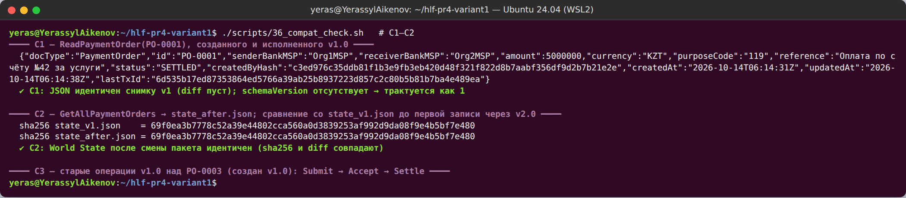

*Рисунок 34 — Объект v1.0 читается через v2.0 без изменений; хэш состояния до и после смены пакета совпадает*

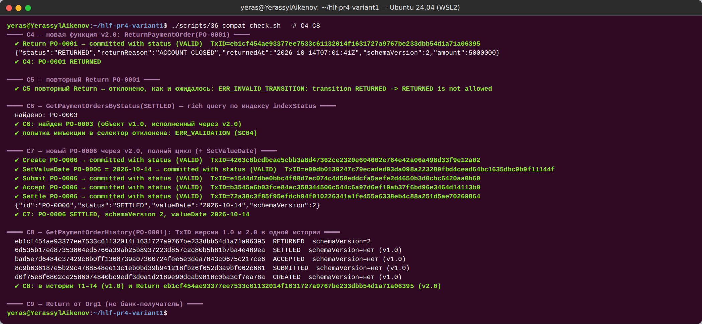

*Рисунок 35 — Старая операция над объектом v1.0, новая функция Return, история с TxID обеих версий*

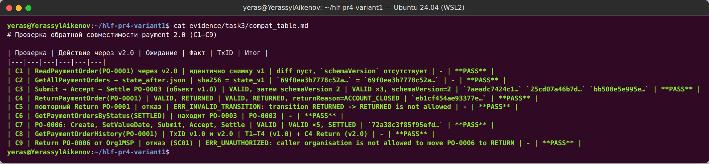

*Рисунок 36 — Итоговая таблица C1–C9: все PASS*

### 6.5. План обновления инфраструктуры Fabric 2.5 → 3.1.x

Полный план — `docs/upgrade/fabric-2.5-to-3.1-plan.md` (со ссылками на `upgrade`, `upgrade_to_newest_version`, `upgrading_your_components`, `updating_capabilities`, release notes). Кратко, по последовательности **Backup → Orderers → Peers → Verification → Channel Capabilities**:

0. **Предусловия:** нет system channel (Channel Participation API — у нас `systemChannel: null`); нет Solo и Kafka (удалены в 3.0; у нас etcdraft); нет legacy lifecycle (удалён в 3.0; Application capability V2_5, все chaincode в `_lifecycle`); `OrdererEndpoints` на уровне организаций; ревизия `core.yaml`/`orderer.yaml`; сборка chaincode в `fabric-ccenv:3.1.5` (Go 1.26.4); CouchDB; клиенты на Fabric Gateway.
1. **Backup:** ledger `/var/hyperledger/production`, MSP/TLS, конфиги, БД Fabric CA, CouchDB (бэкап CouchDB старше бэкапа peer); останов → копия → sha256 → шифрование → проверка восстановимости.
2. **Orderers:** по одному (rolling), после каждого — проверка кворума Raft, лидера и высот (`osnadmin`).
3. **Peers:** по одному на организацию, вместе со своим CouchDB; удаление контейнеров и образов chaincode (пересоберутся в новом ccenv).
4. **Verification:** версии, равные высоты и `currentBlockHash`, `querycommitted`, тестовая транзакция через Gateway, логи без ошибок.
5. **Channel Capabilities `V3_0`:** только после обновления всех узлов; config update (fetch → decode → правка → `compute_update` → подписи Admins по политике → submit). **Точка невозврата** — откат бинарников на 2.5 после V3_0 невозможен.

Также: план отката по этапам, матрица рисков, окно обслуживания и критерии Go/No-Go.

**Практическое подтверждение этапа Backup** (`scripts/38_backup_volumes.sh`, `evidence/task3/38_backup.log`, 17 ✔): узлы остановлены, CouchDB заархивирован раньше ledger, архивы томов orderer/peers, `organizations/` и `channel-artifacts/` зашифрованы AES-256-CBC (PBKDF2, ключ только в `.secrets/`), посчитаны sha256; после запуска высота 64 и `currentBlockHash` не изменились; каждый архив расшифрован и сверен. **Восстановимость доказана на практике:** после стенда SmartBFT основная сеть восстановлена из этого бэкапа (`scripts/40_restore_main.sh`, 13 ✔) — высота 64 и `currentBlockHash pvthqFOPl0vrLbxyVbdhyfPTTARJGfZmGXeHcT+HKrA=` совпали с моментом бэкапа, история PO-0001 содержит исходные TxID.

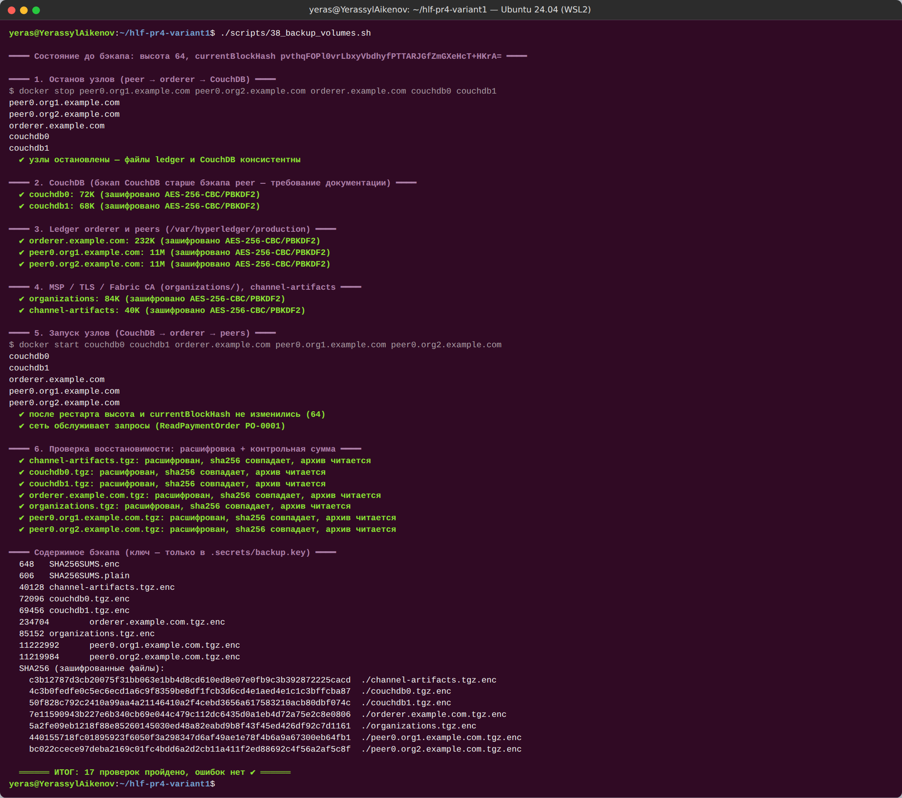

*Рисунок 37 — Консистентный зашифрованный бэкап и проверка восстановимости*

## 7. SmartBFT и итоговый вывод

### 7.1. Стенд (задание 3.7)

Основная сеть остановлена после бэкапа и подтверждения пользователя; стенд поднят командой `./network.sh up createChannel -bft -c bftchannel -ca -s couchdb` (флаг `-bft` совместим с `-ca` — `registerEnroll.sh` выпускает идентичности orderer…orderer4 — и с `-s couchdb`). Конфигурация канала (`evidence/task3/bft/39_bft_config.log`): **ConsensusType = BFT**, channel capability **V3_0**, 4 consenter-а (OrdererMSP):

| ID | Orderer | Порт | Admin (osnadmin) | Operations |
|---|---|---|---|---|
| 1 | orderer.example.com | 7050 | 7053 | 9443 |
| 2 | orderer2.example.com | 7052 | 7055 | 9446 |
| 3 | orderer3.example.com | 7056 | 7057 | 9447 |
| 4 | orderer4.example.com | 7058 | 7059 | 9448 |

Параметры SmartBFT: `request_batch_max_count 100`, `request_batch_max_interval 50ms`, `request_forward_timeout 2s`, `request_complain_timeout 20s`, `view_change_timeout 20s`, `leader_heartbeat_timeout 1m0s`, `leader_rotation ROTATION_UNSPECIFIED`. В `bftchannel` развёрнут `payment` 2.0 (AND-политика) — Package ID совпал с основной сетью (`14d12cad…`), что подтверждает детерминированность упаковки. Лист 3 схемы сверен и дополнен портами.

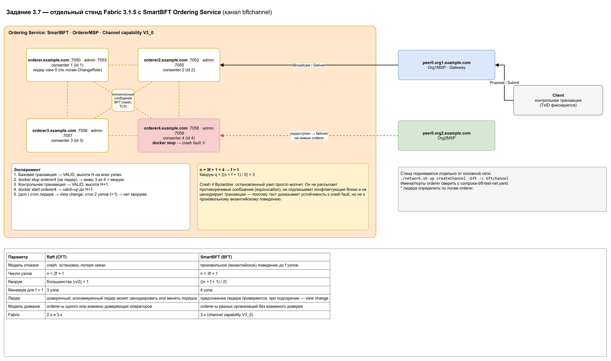

*Рисунок 38 — Стенд SmartBFT (лист 3 схемы) и сравнение Raft / SmartBFT*

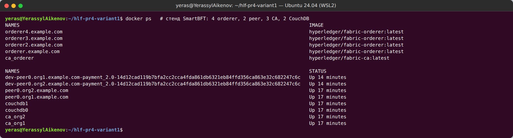

*Рисунок 39 — 4 orderer, 2 peer, 3 Fabric CA, 2 CouchDB*

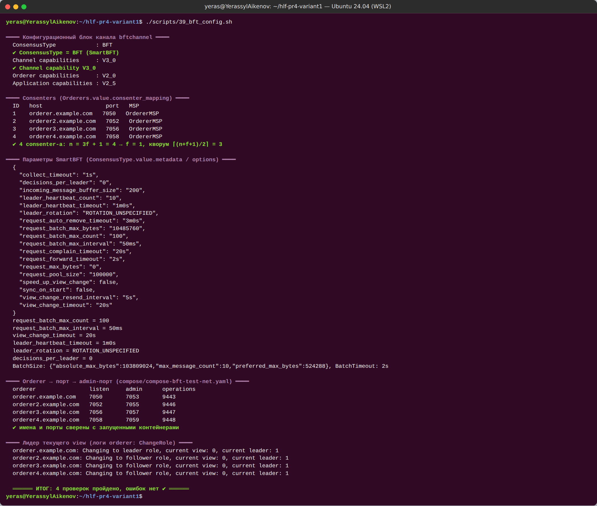

*Рисунок 40 — ConsensusType BFT, consenters, параметры SmartBFT, V3_0, лидер текущего view*

### 7.2. Эксперимент

`scripts/39_bft_experiment.sh` (`evidence/task3/bft/39_bft_experiment.log`, 13 ✔, `experiment.md`). Лидер определяется по последней строке `ChangeRole` в логах orderer, высоты — `osnadmin channel list` на admin-порту каждого orderer и `peer channel getinfo` на каждом peer. Прогон 1 (`*_run1.*`) дал те же результаты; ниже — финальный прогон 2.

| Шаг | Действие | Живые | Кворум | Результат | TxID | Высоты (o1/o2/o3/o4/p1/p2) |
|---|---|---|---|---|---|---|
| E1 | базовая транзакция | 4/4 | да | VALID | `c352d132…eff9` | 12/12/12/12/12/12 |
| E2 | `docker stop orderer4` (не лидер) | 3/4 | да (3 ≥ 3) | — | — | 12/12/12/—/12/12 |
| E3 | **контрольная транзакция при n − 1** | 3/4 | да | **VALID** | `421a1005524b5157a406370d1b32d0976e8eb941c199b9e5a39a790596b48097` | 13/13/13/—/13/13 |
| E4 | `docker start orderer4` → catch-up, транзакция | 4/4 | да | VALID | `833f7a41…4b7b` | 14/14/14/14/14/14 |
| E5 | стоп **лидера** (orderer3, view 2) → view change, транзакция через orderer2 | 3/4 | да | VALID за 55.5 с | `d4c4aecb…e42c` | 15/15/—/15/15/15 |
| E6 | `docker start orderer3` → catch-up | 4/4 | да | — | — | 15/15/15/15/15/15 |
| E7 | стоп **двух** orderer (orderer3, orderer) | 2/4 | **нет** (2 < 3) | блок не сформирован, таймаут 40 с | позже `51db99ec…646e` | —/15/—/15/15/15 |
| E8 | старт обоих → транзакция | 4/4 | да | VALID за 63 с | `6093a49f…bf9c` | 16/16/16/16/16/16 |

Наблюдения по логам:
- **Отказ не-лидера (E2–E3):** живые узлы фиксируют недоступность (`sendMessage … to orderer4(orderer4.example.com:7058)`), консенсус продолжается на 3 узлах — ровно кворум.
- **Catch-up (E4):** перезапущенный orderer4 не догоняет канал «сам по себе» — синхронизация (`detectTargetHeight -> Detected target height: 14`) происходит при следующем раунде консенсуса; после транзакции E4 высоты всех 6 узлов равны.
- **Отказ лидера (E5):** запрос к follower-у не упорядочивается → `OnRequestTimeout` / `OnLeaderFwdRequestTimeout` (таймауты 2 с и 20 с) → жалобы follower-ов → **view change** → `Changing to leader role, current view: 3, current leader: 4`; транзакция зафиксирована через ≈ 56 с после остановки лидера.
- **Нет кворума (E7):** блок не формируется, высоты не растут, клиент получает таймаут ожидания. Транзакция при этом **не потеряна**: она осталась в request pool и после восстановления кворума упорядочена в блок 15 вместе с E8 (VALID). Блок 15 подписан **тремя** orderer-ами (metadata SIGNATURES = 3 ≥ кворума; в Raft-канале — 1 подпись).

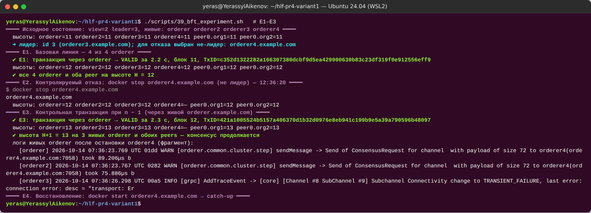

*Рисунок 41 — E1–E3: отказ не-лидера и контрольная транзакция VALID на высоте H+1*

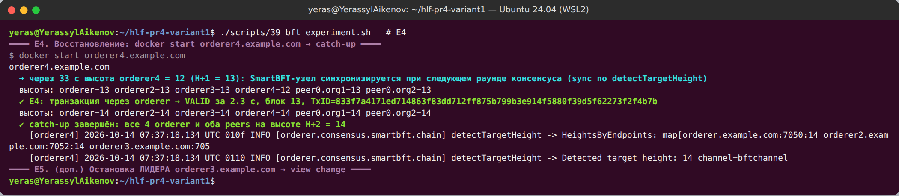

*Рисунок 42 — E4: docker start orderer4, синхронизация, высоты всех узлов равны*

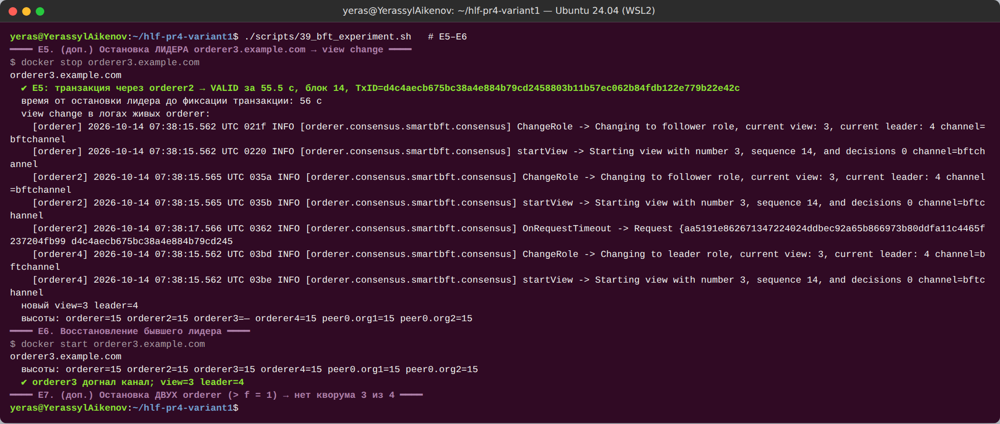

*Рисунок 43 — E5–E6: остановка лидера, view change, новая транзакция VALID*

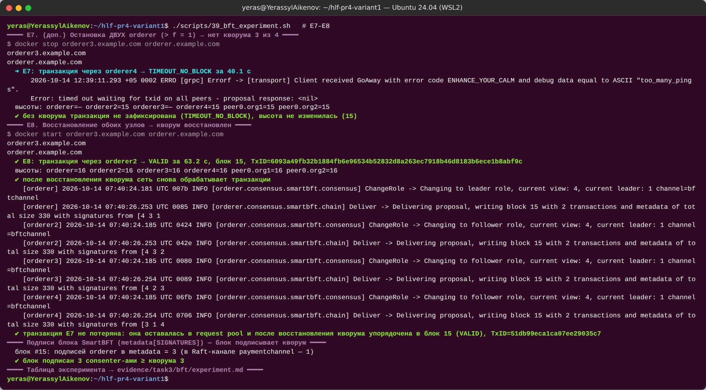

*Рисунок 44 — E7–E8: два узла остановлены — блок не формируется; после восстановления транзакция упорядочена, блок подписан 3 consenter-ами*

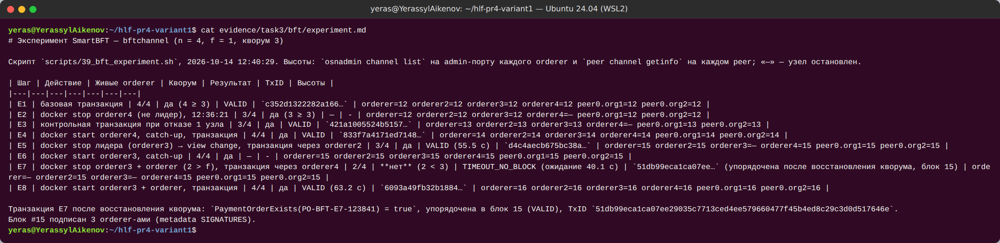

*Рисунок 45 — Сводная таблица эксперимента SmartBFT*

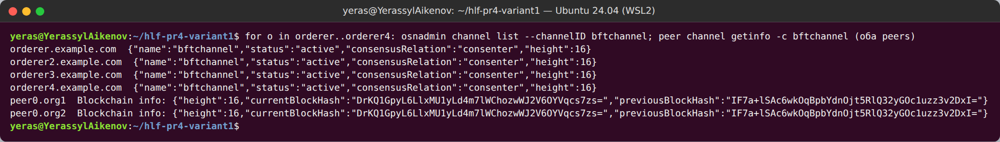

*Рисунок 46 — Итоговые высоты: все 4 orderer и оба peers на высоте 16, одинаковый currentBlockHash*

### 7.3. Анализ: crash fault vs Byzantine fault

**Арифметика.** n = 3f + 1 = 4 ⇒ f = 1; кворум q = ⌈(n + f + 1)/2⌉ = ⌈6/2⌉ = 3. При одном отказе остаётся 3 = q (E3, E5 — работа продолжается), при двух — 2 < q (E7 — блок не формируется). Любые два кворума по 3 из 4 пересекаются минимум в 2 узлах, из которых хотя бы один честный при f = 1, — поэтому два конфликтующих блока одной высоты не могут быть подписаны.

**Почему `docker stop` доказывает только устойчивость к crash.** Остановленный контейнер просто **молчит**: не отвечает, не подписывает, не рассылает сообщений. Византийский узел может вести себя произвольно: рассылать разным узлам противоречивые предложения (equivocation), подписывать конфликтующие блоки, предлагать некорректные блоки, будучи лидером, цензурировать или переупорядочивать транзакции, выборочно задерживать доставку, отправлять корректные по формату, но ложные сообщения view change. Эксперимент не создаёт ни одной из этих ситуаций, поэтому подтверждает только, что протокол переживает «молчащий» узел и смену лидера.

**Что потребовалось бы для проверки BFT:** модифицированный orderer с внедрением ошибок (equivocation, подпись конфликтующих предложений, задержка/искажение сообщений протокола), сетевые разбиения и задержки (`tc netem`, `iptables`) между конкретными парами узлов, лидер, цензурирующий транзакции одной организации, проверка обнаружения и view change в этих условиях; для гарантий — формальная верификация протокола (TLA+, модель-чекинг) и аудит реализации библиотеки SmartBFT.

**Сравнение с Raft основной сети.** Основная сеть использует Raft с **одним** orderer: его остановка означает полную остановку упорядочивания (n = 1 ⇒ f = 0). Raft (CFT, n = 2f + 1) переживает отказ меньшинства узлов, но доверяет лидеру: злонамеренный лидер может цензурировать или переставлять транзакции, а блок подписывает один узел. SmartBFT (BFT, n = 3f + 1) проверяет предложения лидера, требует подписей кворума (3 подписи в блоке 15) и заменяет подозрительного лидера через view change, но платит за это числом узлов (4 вместо 3 для f = 1), задержками (≈ 55 с на смену лидера при настройках по умолчанию) и пропускной способностью. Выбор — по модели доверия: Raft, если orderer-ы принадлежат одному оператору или взаимно доверяющим сторонам; SmartBFT — если узлы упорядочивания распределены между банками без взаимного доверия.

### 7.4. Итоговый вывод по работе

**Что получилось.** Развёрнута корпоративная сеть Fabric 3.1.5 с Fabric CA и CouchDB; chaincode `payment` с state machine, валидацией и AND-политикой выполнен в 9 VALID-транзакциях с реальными TxID, транзакция T4 разобрана по пяти этапам из реального блока, проверена хэш-цепочка ledger и продемонстрирован `MVCC_READ_CONFLICT`. Построена модель угроз (15 угроз STRIDE/DREAD), уязвимость отсутствия авторизации воспроизведена от имени Org2 и устранена в `paymentsecure` (MSP + роль + четыре глаза + инварианты); расчётные реквизиты изолированы в PDC и доказуемо отсутствуют в публичной части ledger и у Org2; 17/17 security-тестов. Выполнено обновление `payment` 1.0/1 → 2.0/2 с побайтным сохранением состояния (sha256), разработан план обновления 2.5 → 3.1.x и практически проверены его этапы Backup и восстановление; эксперимент SmartBFT подтвердил устойчивость к отказу одного orderer и потере лидера и показал остановку при потере кворума.

**Ограничения.** Стенд — одна машина, по одному peer на организацию, Raft с одним orderer в основной сети; секреты test-network (bootstrap-пароли CA, CouchDB) — по умолчанию; ключи на диске, а не в HSM; эксперимент BFT проверяет только crash faults.

**Что улучшить для production:** HSM/PKCS#11 для ключей, отдельные TLS CA, mTLS для клиентов; несколько peers на организацию и ≥ 3 orderer у разных операторов (или SmartBFT при отсутствии доверия); state-based endorsement для отдельных поручений; `PurgePrivateData` по регламенту хранения; мониторинг (operations endpoints, Prometheus), централизованный сбор логов с маскированием; регулярные учения по восстановлению из бэкапа; CI с unit/security-тестами, gosec/govulncheck и проверкой детерминизма для каждого изменения chaincode.
