<div align="center">

**Astana IT University**
**School of Cybersecurity**

&nbsp;

# Практическая работа №4

## Разработка, обеспечение безопасности и обновление корпоративной блокчейн-сети Hyperledger Fabric

**Вариант 1 — «Банковские операции»**
Org1 — Банк-отправитель · Org2 — Банк-получатель · бизнес-объект PaymentOrder · конфиденциальные данные — расчётные реквизиты

&nbsp;

Выполнил: **Айкенов Ерасыл Әлкенұлы**, группа **SSE-2502**
Проверил: `<ФИО преподавателя>`

&nbsp;

Астана, 2026

</div>

---

## Соответствие требованиям задания

| Пункт | Требование | Раздел | Доказательство | Статус |
|---|---|---|---|---|
| 1.1 | Сеть: 2 организации, peers, Ordering Service, Fabric CA, отдельный канал | 2.1 | `evidence/task1/02_network_up.log` | ✅ |
| 1.2 | CLI и административная идентичность Org1 (Peer + Orderer) | 2.3 | `task1/04_cli_env_org1.log` | ✅ |
| 1.3 | Архитектурная схема; chaincode ≥ 6 операций, валидация, переходы | 2.2, 3.1 | `docs/architecture/`, `task1/07_static_analysis.log` | ✅ |
| 1.4 | Деплой 1.0 / 1, политика обеих организаций, querycommitted | 3.2 | `task1/08_lifecycle_payment_1.0.log` | ✅ |
| 1.5 | ≥ 4 транзакции с TxID; разбор одной по этапам | 3.3, 3.4 | `task1/txids.csv` (9 VALID), `tx_anatomy_6d535b17….md` | ✅ |
| 1.6 | Состояние бизнес-объектов | 3.5 | `task1/12_state.log` | ✅ |
| 1.7 | Ledger: высота, последний блок, Blockchain vs World State | 3.6 | `task1/13_ledger_info.log` | ✅ |
| 2.1 | Модель угроз, STRIDE ≥ 6 угроз по 7 компонентам | 4.1 | `docs/security/threat-model.md` (15 угроз) | ✅ |
| 2.2 | Уязвимая версия с одной ошибкой под отдельным именем | 4.4 | `paymentvuln`, `task2/22_vuln_diff.patch` | ✅ |
| 2.3 | Воспроизведение от Org2, нарушенный инвариант | 4.4 | `task2/21_exploit.log` | ✅ |
| 2.4 | Защищённая версия: MSP, идентичность, роли, переходы, инварианты, GetTransient/PutPrivateData/GetPrivateData | 4.5 | `chaincode/payment-secure`, `task2/25_exploit_secure.log` | ✅ |
| 2.5 | PDC только для разрешённой организации, отдельное имя | 5.1 | `task2/24_lifecycle_paymentsecure.log` | ✅ |
| 2.6 | Transient; реквизитов нет в аргументах и публичном ledger | 5.2 | `task2/23_private_flow.log` | ✅ |
| 2.7 | ≥ 6 security-тестов; Org1 читает, Org2 — отказ | 5.3 | `task2/security_tests.md` (17 PASS) | ✅ |
| 3.1 | Исходное состояние 1.0 / 1, Package ID, объекты | 6.1 | `task3/30_pre_upgrade/` | ✅ |
| 3.2 | Chaincode 2.0, совместимость, Package ID | 6.2 | `chaincode/payment-v2`, `task3/33_install_payment_2.0.log` | ✅ |
| 3.3–3.5 | Install, approve 2.0 / 2 с той же политикой, commit | 6.3 | `task3/34_*.log`, `task3/35_commit.log` | ✅ |
| 3.6 | Совместимость (объект v1, старая и новая операции); план 2.5 → 3.1.x | 6.4, 6.5 | `task3/compat_table.md`, `docs/upgrade/fabric-2.5-to-3.1-plan.md` | ✅ |
| 3.7 | Стенд SmartBFT, отказ одного orderer, контрольная транзакция, восстановление | 7 | `task3/bft/experiment.md` | ✅ |

**Пороги оценки.** Сеть и chaincode работают (порог 50) — разделы 2–3; есть практическое доказательство разграничения доступа и исправления уязвимой бизнес-логики (порог 70) — разделы 4.4–5.3; выполнено обновление sequence 1 → 2 с доказательством сохранения старого состояния (порог 80) — раздел 6. Закрытые ключи, пароли и сертификаты с ключами в отчёт и репозиторий не включены (`evidence/final/scan_secrets.log`).

Все TxID, Package ID, номера блоков и хэши в отчёте получены из реально выполненных команд; их наличие в `evidence/` проверено скриптом `scripts/verify_report_facts.sh` (`evidence/final/verify_report_facts.md`). Скриншоты — снимки терминала WSL2 (Ubuntu 24.04) с выводом команд, выполненных на сети; часть скриншотов показывает фрагменты логов `evidence/`, записанных в момент выполнения (команда показа видна в заголовке окна).

\newpage

## 1. Цель работы и описание предметной области

**Цель работы** — получить практические навыки проектирования корпоративной блокчейн-сети Hyperledger Fabric, разработки chaincode, управления идентификацией и конфиденциальностью, анализа угроз, проверки бизнес-логики, а также безопасного обновления chaincode и компонентов сети.

**Вариант 1 — «Банковские операции».** Два банка обмениваются платёжными поручениями через общий permissioned-реестр:

| Роль | Организация | MSP ID | Что делает |
|---|---|---|---|
| Банк-отправитель (Sender Bank) | Org1 | `Org1MSP` | создаёт платёжное поручение, вводит расчётные реквизиты, авторизует списание |
| Банк-получатель (Receiver Bank) | Org2 | `Org2MSP` | принимает или отклоняет поручение, исполняет (зачисляет) платёж |
| Ordering Service | OrdererOrg | `OrdererMSP` | упорядочивает транзакции и формирует блоки |

**Бизнес-объект** — `PaymentOrder` (платёжное поручение) с жизненным циклом `CREATED → SUBMITTED → ACCEPTED → SETTLED` (а также `REJECTED`, `CANCELLED`; в версии 2.0 — `RETURNED`). **Конфиденциальные данные** — расчётные реквизиты (IBAN плательщика и получателя, BIC, БИН/ИИН, наименование получателя): их видит только банк-отправитель, банк-получатель может лишь сверить хэш.

**Почему permissioned-реестр и AND-политика.** Межбанковский платёж — совместный процесс двух юридически независимых сторон, ни одна из которых не должна единолично управлять общей записью. Fabric даёт идентифицированных участников (X.509 от Fabric CA), неизменяемый журнал операций и политику подтверждения `AND('Org1MSP.peer','Org2MSP.peer')`: результат каждой транзакции должны подписать peers **обоих** банков, поэтому ни один банк не может записать в реестр результат, не воспроизводимый у другой стороны.

**Среда выполнения:** Windows 11 + WSL2 (Ubuntu 24.04.5 LTS), Docker Engine 29.8.2 (Docker Desktop), Docker Compose v5.6.0, Go 1.27.2 (хост) / Go 1.26.4 (образ `fabric-ccenv:3.1.5`), **Hyperledger Fabric 3.1.5**, **Fabric CA 1.5.22** — последние patch-версии, определённые через GitHub Releases API (`evidence/task1/01_versions.log`).

## 2. Архитектура сети

### 2.1. Создание сети (задание 1.1)

Сеть создана на базе `fabric-samples/test-network` командой `./network.sh up createChannel -c paymentchannel -ca -s couchdb` (`scripts/02_network_up.sh`): идентичности выпускает **Fabric CA** (`-ca`), World State хранится в **CouchDB** (`-s couchdb`). Результат — 2 организации, 2 peer, Raft-orderer, 3 Fabric CA, 2 CouchDB, канал `paymentchannel` (`evidence/task1/02_network_up.log`, 11 проверок ✔).


*Рисунок 1 — Контейнеры сети: peer0.org1/peer0.org2, orderer, ca_org1/ca_org2/ca_orderer, couchdb0/couchdb1, контейнеры chaincode*

### 2.2. Архитектурная схема (задание 1.3)


*Рисунок 2 — Архитектура сети с доверительными границами TB1–TB6 (`docs/architecture/architecture_variant1.drawio`, лист 1). Схема сверена с реальной сетью: имена контейнеров, порты, имена CA и CouchDB совпадают.*

| Компонент | Контейнер | Порт | MSP | Роль в варианте 1 |
|---|---|---|---|---|
| Peer + Fabric Gateway | `peer0.org1.example.com` | 7051 | Org1MSP | endorser/committer банка-отправителя, Gateway для Sender Bank App |
| Peer + Fabric Gateway | `peer0.org2.example.com` | 9051 | Org2MSP | endorser/committer банка-получателя |
| Ordering Service (Raft) | `orderer.example.com` | 7050, admin 7053 | OrdererMSP | упорядочивание, блоки, Channel Participation API |
| Fabric CA | `ca_org1` / `ca_org2` / `ca_orderer` | 7054 / 8054 / 9054 | Org1MSP / Org2MSP / OrdererMSP | X.509, атрибут `role` |
| World State | `couchdb0` / `couchdb1` (CouchDB 3.4.2) | 5984 / 7984 | — | текущие значения ключей; private data только у Org1 |
| Chaincode | `dev-peer0.orgN…-payment_*` | — | — | бизнес-логика PaymentOrder |
| Client Application | `client/payment-client` (Go, fabric-gateway 1.10.0) | — | Org1MSP/Org2MSP | Submit/Evaluate через Gateway |
| Channel / Ledger | `paymentchannel` | — | Org1MSP, Org2MSP, OrdererMSP | общий Blockchain + World State каждого peer |

Поток транзакции ①–⑥ (Execute → Order → Validate → Commit): ① клиент подписывает proposal и отправляет в Gateway своей организации (gRPC+TLS); ② Gateway выполняет симуляцию на peer0.org1 и запрашивает endorsement у peer0.org2 (политика AND), формируются Read/Write Set; ③ клиент подписывает транзакцию, Gateway передаёт её в Ordering Service; ④ orderer упорядочивает транзакции и доставляет блок peers; ⑤ каждый peer проверяет Endorsement Policy (VSCC) и версии ключей (MVCC), применяет write-set валидных транзакций к World State и дописывает блок целиком; ⑥ клиент получает статус фиксации (TxID + код валидации).


*Рисунок 3 — Поток Execute → Order → Validate → Commit и путь private data (лист 2 схемы)*

### 2.3. CLI-окружение и административная идентичность Org1 (задание 1.2)

`scripts/env_org1.sh` / `env_org2.sh` (через `source`) повторяют `test-network/scripts/envVar.sh`: `PATH`, `FABRIC_CFG_PATH`, `CORE_PEER_TLS_ENABLED=true`, `CORE_PEER_LOCALMSPID`, `CORE_PEER_TLS_ROOTCERT_FILE`, `CORE_PEER_MSPCONFIGPATH` (Admin@org1.example.com), `CORE_PEER_ADDRESS`, `ORDERER_CA`, TLS-корни обоих peers; переменная `ORG_USER` переключает пользователя. Доказательство (`evidence/task1/04_cli_env_org1.log`, 7 ✔): `peer channel list` и `peer channel getinfo` (работа с Peer); `peer channel fetch config` — получен конфигурационный блок №2 от Ordering Service; идентичность администратора: `subject=… OU = admin, CN = org1admin`, `issuer=… CN = ca.org1.example.com`, NodeOUs включены (`AdminOUIdentifier = admin`). Ключ и PEM в отчёт не выводятся.


*Рисунок 4 — CLI-окружение Org1 Admin: версия peer 3.1.5, канал paymentchannel*


*Рисунок 5 — Получение конфигурации канала от Ordering Service, параметры канала (etcdraft, capabilities V2_0 / V2_5) и subject/issuer сертификата Admin@org1*

## 3. Chaincode, Endorsement Policy и транзакции

### 3.1. Chaincode `payment` v1.0

Go, `fabric-contract-api-go/v2` v2.2.0 (`chaincode/payment-v1`), спецификация — `docs/chaincode/payment-v1-spec.md`.

| Функция | Тип | Кто вправе | Переход | Требование задания |
|---|---|---|---|---|
| `CreatePaymentOrder(id, receiverBankMSP, amount, currency, purposeCode, reference)` | submit | Org1MSP | ∅ → CREATED | создание объекта |
| `ReadPaymentOrder(id)` | evaluate | члены канала | — | чтение |
| `SubmitPaymentOrder(id)` | submit | MSP = senderBankMSP | CREATED → SUBMITTED | изменение состояния |
| `AcceptPaymentOrder(id)` | submit | MSP = receiverBankMSP | SUBMITTED → ACCEPTED | изменение состояния |
| `RejectPaymentOrder(id, reasonCode)` | submit | MSP = receiverBankMSP | SUBMITTED → REJECTED | изменение состояния |
| `SettlePaymentOrder(id)` | submit | MSP = receiverBankMSP | ACCEPTED → SETTLED | **основная бизнес-операция** |
| `CancelPaymentOrder(id)` | submit | MSP = senderBankMSP | CREATED / SUBMITTED → CANCELLED | изменение состояния |
| `PaymentOrderExists(id)` | evaluate | члены канала | — | проверка существования |
| `GetAllPaymentOrders(pageSize, bookmark)` | evaluate | члены канала | — | список (пагинация 1..50) |
| `GetPaymentOrderHistory(id)` | evaluate | члены канала | — | история ключа |

Матрица авторизации: Org1MSP — Create, Submit, Cancel; Org2MSP — Accept, Reject, Settle; оба — чтение. Таблица допустимых переходов — единственный источник истины (`allowedTransitions()`), любой другой переход → `ERR_INVALID_TRANSITION`; SETTLED, REJECTED, CANCELLED — терминальные.

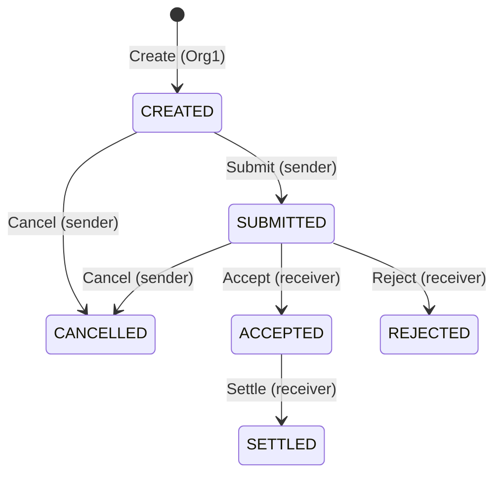

**Валидация входных данных** (OWASP SC04/SC08): ID `^PO-[A-Z0-9-]{4,32}$`; сумма — целое в тиынах, regex без знака/экспоненты/ведущих нулей + `strconv.ParseInt` + верхняя граница 10¹⁴; валюта из белого списка ISO 4217; КНП — 3 цифры; назначение платежа ≤ 140 символов, валидный UTF-8 без управляющих символов. Время — только `GetTxTimestamp` (детерминизм), идентичность создателя хранится как `sha256(GetID())`.

**Тесты и анализ** (`evidence/task1/07_static_analysis.log`): 70 unit-тестов (counterfeiter-моки + in-memory ledger; каждый из 24 недопустимых переходов, каждая функция от «чужого» MSP, 26 табличных тестов валидации), покрытие **97.0 %**; `go vet`, `staticcheck`, `gosec`, `govulncheck` — 0 находок; `check_determinism.sh` — 0 находок.

**Найденный при первом деплое дефект.** Первая попытка транзакций (`evidence/task1/attempt1/`) завершилась отказом endorsement: `value did not match schema: rejectReason is required`. `contractapi` валидирует возвращаемые значения по сгенерированной JSON-схеме и считает поле с `omitempty` обязательным, если оно не помечено `metadata:",optional"`. Unit-тесты, вызывающие методы напрямую, этого не видели. Исправлено тегом, добавлен регрессионный тест через `ContractChaincode.Invoke` (тот же путь, что у peer), проверено, что без тега тест падает с тем же сообщением. Так как исправленный код — новый пакет, сеть была пересоздана **до** получения каких-либо доказательств, чтобы основной chaincode имел ровно version 1.0 / sequence 1.


*Рисунок 6 — Unit-тесты, покрытие и статический анализ chaincode payment v1.0*

### 3.2. Развёртывание: version 1.0, sequence 1, политика AND (задание 1.4)

`scripts/lifecycle.sh` — явный жизненный цикл без `network.sh deployCC`: `go mod vendor` → `peer lifecycle chaincode package` → `calculatepackageid` → `install` на peer0.org1 и peer0.org2 → `approveformyorg` Org1 → `checkcommitreadiness` (`Org1MSP: true, Org2MSP: false`) → `approveformyorg` Org2 → `checkcommitreadiness` (`true / true`) → `commit` с обоими peers → `querycommitted`. Флаг `--signature-policy "AND('Org1MSP.peer','Org2MSP.peer')"` передавался идентично во все команды.

- **Package ID:** `payment_1.0:41e4157887f433f851ad7fcb43f449aff92a55a8a0f855676c5319d3e6769748`
- `querycommitted`: `"sequence": 1, "version": "1.0"`, `approvals: {Org1MSP: true, Org2MSP: true}`, `validation_parameter` декодирован как ApplicationPolicy: **2-out-of-2 [Org1MSP, Org2MSP], role PEER** = `AND('Org1MSP.peer','Org2MSP.peer')`.


*Рисунок 7 — Package ID, установка на оба peers, переход readiness Org2MSP false → true*


*Рисунок 8 — Зафиксированное определение: Version 1.0, Sequence 1, политика AND, approvals обеих организаций*

### 3.3. Транзакции с TxID (задание 1.5)

`scripts/10_transactions.sh`; номер блока и код валидации определены из реального блока (`qscc GetBlockByTxID` → `configtxlator`), а не по догадке. Полный список — `evidence/task1/txids.csv`.

| # | Операция | От имени | TxID | Блок | Код |
|---|---|---|---|---|---|
| T1 | Create PO-0001 (5 000 000 тиын, KZT, КНП 119) | Org1MSP/Admin | `d0f75e8f6802ce2586074840bc9edf3d0a1d2189e90dcab9818c0ba3cf7ea78a` | 6 | VALID |
| T2 | Submit PO-0001 | Org1MSP/Admin | `8c9b636187e5b29c4788548ee13c1eb0bd39b941218fb26f652d3a9bf062c681` | 7 | VALID |
| T3 | Accept PO-0001 | Org2MSP/Admin | `bad5e7d6484c37429c8b0ff1368739a07300724fee5e3dea7843c0675c217ce6` | 8 | VALID |
| T4 | **Settle PO-0001** — основная бизнес-операция | Org2MSP/Admin | `6d535b17ed87353864ed5766a39ab25b8937223d857c2c80b5b81b7ba4e489ea` | 9 | VALID |
| T5 | Create PO-0002 **через Fabric Gateway** (Go-клиент) | Org1MSP/Admin | `69f6d6bd56354453d50261bf486f6fe82ecadedd6df9b923842269d8b2e501ce` | 10 | VALID |
| T6 | Cancel PO-0002 | Org1MSP/Admin | `499123ba236b5ac0e2f552f3b74a0a919fd259edff225698f0406ac8054f36ba` | 11 | VALID |
| T7 | Create PO-0003 (остаётся CREATED для Задания 3) | Org1MSP/Admin | `43dd8a91382e11845a39f520b66714bbbcccedccc91cec4eabbf278e801bec67` | 12 | VALID |
| N1 | Settle PO-0003 из CREATED | Org2MSP/Admin | — | — | отказ при endorsement: `ERR_INVALID_TRANSITION: transition CREATED -> SETTLED is not allowed` |
| N2 | Create PO-0004 от Org2 | Org2MSP/Admin | — | — | отказ: `ERR_UNAUTHORIZED: caller organisation may not create payment orders` |
| T8 | Create PO-0005 (MVCC-демо) | Org1MSP/Admin | `d949c0a625223cd7a90bedd4e0fb11c3bf8c90822cd14ba55e4074284a4250d0` | 13 | VALID |
| M2 | Cancel PO-0005 (параллельно с M1) | Org1MSP/Admin | `0fadf26417fdb06941482a121da4b3e6a5b29123a2fb1a9e55ba77cb6f3026b3` | 14 | VALID |
| M1 | Submit PO-0005 (параллельно с M2) | Org1MSP/Admin | `9f45207008f0416c6cc665bf14adbfd5e3b420c9caf4412fe0f330ca1c889de2` | 14 | **MVCC_READ_CONFLICT** |

Итого 9 VALID-транзакций (требуется ≥ 4), одна — через Gateway-клиент. N1 и N2 отклонены на этапе Execute и в ledger не попали. **MVCC-демо:** Submit и Cancel одного ключа отправлены параллельно, оба endorse-ились по одной версии ключа, упорядочены в один блок 14; валидатор принял первую (Cancel) и пометил вторую `MVCC_READ_CONFLICT` — её write-set не применён, но транзакция хранится в блоке.


*Рисунок 9 — Транзакции T1–T4 через peer CLI и T5 через Fabric Gateway; TxID и блоки*


*Рисунок 10 — Недопустимый переход (N1) и создание поручения банком-получателем (N2) отклонены chaincode*


*Рисунок 11 — Две параллельные транзакции над PO-0005 в одном блоке: VALID и MVCC_READ_CONFLICT*


*Рисунок 12 — Клиентское приложение на Fabric Gateway (Org2 читает PO-0002; T5 — запись через Gateway)*

### 3.4. Разбор транзакции T4 по этапам

`scripts/analyze_tx.sh` → `evidence/task1/tx_anatomy_6d535b17….md`. Все значения взяты из реального блока 9.

| Этап | Данные из блока |
|---|---|
| **Proposal** | тип 3 `ENDORSER_TRANSACTION`, канал `paymentchannel`, chaincode `payment`, функция `SettlePaymentOrder(PO-0001)` (аргументы декодированы из base64), создатель **Org2MSP** (`CN = org2admin`), timestamp `2026-10-14T06:14:38.531737903Z`. **TxID = SHA-256(nonce ‖ creator)** — пересчитан скриптом и совпал с tx_id; поэтому клиент не выбирает TxID произвольно, а повтор отклоняется как `DUPLICATE_TXID`. |
| **Endorsement** | endorsers **Org2MSP, Org1MSP**, 2 подписи (сами подписи не приводятся), ответ chaincode status 200, версия chaincode 1.0, событие `PaymentOrderSettled` (payload без сумм). Read Set: `PO-0001` версии **8/0** (блок 8, транзакция 0 — запись T3). Write Set: `PO-0001`, 466 байт, `status=SETTLED`. |
| **Ordering** | блок **9**, позиция 0 из 1, `data_hash = 0qMqflTmkjURsQu3lxltEjSYiOUMPgsscgabTfsLBTg=`, `previous_hash = j5qeguIDDQMnvNiKRekb2LB4g9SO7ZXTTLnR7pUBRaw=`, подпись orderer в metadata[SIGNATURES] — **OrdererMSP** (`OU = orderer, CN = orderer`). |
| **Validation** | `TRANSACTIONS_FILTER[0] = 0 (VALID)`: VSCC — подписи Org1MSP и Org2MSP удовлетворяют AND; MVCC — версия 8/0 совпала с World State. |
| **Commit** | лог peer0.org1: `Committed block [9] with 1 transaction(s) … commitHash=[9c4535…19ae]` (то же на peer0.org2); `ReadPaymentOrder(PO-0001)` → SETTLED, `GetPaymentOrderHistory` содержит этот TxID. |


*Рисунок 13 — Разбор транзакции T4 Settle по этапам Proposal → Endorsement → Ordering → Validation → Commit*

### 3.5. Состояние бизнес-объектов (задание 1.6)

| Объект | Ожидаемый статус | Фактический | Сумма | lastTxId |
|---|---|---|---|---|
| PO-0001 | SETTLED | SETTLED ✅ | 5 000 000 KZT | `6d535b17…e489ea` (T4) |
| PO-0002 | CANCELLED | CANCELLED ✅ | 120 000 000 USD | `499123ba…f36ba` (T6) |
| PO-0003 | CREATED | CREATED ✅ | 75 000 000 KZT | `43dd8a91…bec67` (T7) |
| PO-0005 | SUBMITTED или CANCELLED | CANCELLED ✅ | 990 000 EUR | `0fadf264…026b3` (M2) |

`GetAllPaymentOrders` с `pageSize = 2` вернул 4 объекта на 2 страницах (bookmark `PO-0003`); `pageSize = 51` отклонён (SC10). `GetPaymentOrderHistory(PO-0001)` содержит все четыре TxID T1–T4. В CouchDB (`paymentchannel_payment` на couchdb0) документ PO-0001 хранится со служебным полем `~version = "CgMBCQA="` — это закодированная версия ключа (блок 9, транзакция 0), используемая MVCC. Учётные данные CouchDB в лог не попадали (`evidence/task1/12_state.log`, 12 ✔).


*Рисунок 14 — ReadPaymentOrder, пагинация и история PO-0001 (T1–T4)*


*Рисунок 15 — Документ PO-0001 в CouchDB peer0.org1 (Fauxton; снимок сделан после Задания 3, поэтому статус RETURNED и schemaVersion 2; пароль на экране отсутствует)*

### 3.6. Исследование Ledger (задание 1.7)

`scripts/13_ledger_info.sh` (`evidence/task1/13_ledger_info.log`, 10 ✔), на момент исследования:

- **Высота** канала — **15** (блоки 0..14), `currentBlockHash = 7+KqMIh3IKXgeMZ1ci6YCLq54Wqg4FcIYEio+N3bCT4=`, `previousBlockHash = SM2MJEjETB/tqhLuPxA5mPwGmWaoXtZA+SZGdv+cxEE=`.
- **Последний блок №14**: `data_hash = vQMdrxR+7qdm6Mz/FxhyyRFjeV7Q+Eo5Xl+ny9iHTAQ=`, 2 транзакции — `0fadf264…` VALID и `9f452070…` MVCC_READ_CONFLICT.
- **Связность:** `previous_hash` блока 14 = `previousBlockHash` из getinfo; хэш заголовка, пересчитанный локально как SHA-256(ASN.1(number, previous_hash, data_hash)), совпал с `currentBlockHash`; хэш заголовка блока 13 записан в `previous_hash` блока 14; пройдена вся цепочка 0..14 — разрывов нет.
- Наблюдение: копия блока, полученная от orderer (`peer channel fetch`), **не содержит** `TRANSACTIONS_FILTER`, а копия из ledger peer (`qscc GetBlockByNumber`) — содержит; заголовки идентичны. Это прямое подтверждение того, что валидацию выполняет peer, а не orderer.
- **Блок 0** — конфигурационная транзакция (тип 1 CONFIG): организации Application `Org1MSP, Org2MSP`, Orderer `OrdererOrg`, MSP с NodeOUs, политики `Admins/Readers/Writers`, `LifecycleEndorsement = MAJORITY Endorsement`, capabilities Channel `V2_0`, Application `V2_5`, Orderer `V2_0`, `ConsensusType = etcdraft`, BatchSize 10 сообщений / BatchTimeout 2 s.


*Рисунок 16 — Высота, последний блок, проверка хэш-цепочки и состав блока 0*

**Blockchain vs World State.** *Blockchain* — неизменяемый журнал **всех** упорядоченных транзакций, включая невалидные: транзакция M1 с `MVCC_READ_CONFLICT` лежит в блоке 14. *World State* (CouchDB) — текущие значения ключей, производная от Blockchain: в нём PO-0005 = CANCELLED с `lastTxId` транзакции M2, write-set M1 не применён. World State можно пересобрать из блоков (`peer node rebuild-dbs`), обратное невозможно. *History DB* — индекс изменений ключа по валидным транзакциям (`GetPaymentOrderHistory`).

### 3.7. Базовый маппинг OWASP SC Top 10 (2025)

Сверено с официальной страницей OWASP (названия SC01–SC10 редакции 2025 совпадают). Подробно — `docs/security/owasp-sc-baseline-v1.md`: SC01 — проверка MSP в каждой изменяющей функции (N2); SC02 — внешних оракулов нет, сумма неизменяема; SC03 — явная state machine (N1); SC04 — строгая валидация; SC05/SC06 — нет `InvokeChaincode`; SC07 — одна транзакция = один переход; SC08 — `ParseInt` + MaxAmount, без float; SC09 — `GetTxTimestamp`, `check_determinism.sh`; SC10 — пагинация с потолком 50, лимиты длины.


## 4. Анализ безопасности

### 4.1. Модель угроз (задание 2.1)

Полная модель — `docs/security/threat-model.md`. Кратко:

- **Активы:** A1 состояние PaymentOrder; A2 расчётные реквизиты; A3 закрытые ключи MSP/TLS; A4 корневые ключи и БД Fabric CA; A5 определение chaincode и Endorsement Policy; A6 конфигурация канала; A7 ключи consenter-ов; A8 целостность Blockchain; A9 доступность сервиса платежей.
- **Участники:** initiator1, approver1 (Org1), processor2 (Org2), администраторы Org1/Org2/Orderer и CA, внешний атакующий, **злонамеренный инсайдер Org2**, скомпрометированные peer и orderer.
- **Доверительные границы** TB1–TB6 — на схеме (рисунок 2): TB1 организация, TB2 Client ↔ Peer/Gateway, TB3 организации ↔ Ordering Service, TB4 Peer ↔ chaincode, TB5 Fabric CA ↔ участники, TB6 внешние клиенты банков ↔ Client Application. DFD с границами — в `threat-model.md` (Mermaid).

STRIDE: 15 угроз, покрыты все 7 компонентов задания и все 6 категорий; риск — DREAD (среднее пяти факторов 0–10).

| ID | Компонент | STRIDE | Сценарий | OWASP | DREAD | Меры | Тест |
|---|---|---|---|---|---|---|---|
| T-01 | Chaincode | E | инсайдер Org2 авторизует списание чужого поручения и проводит платёж до SETTLED | SC01, SC03 | **8.8** | MSP + роль + 4 глаза (Р) | SEC-04 |
| T-02 | Chaincode | T | недопустимый переход, повторное исполнение | SC03 | 7.4 | таблица переходов (Р) | SEC-07, 08 |
| T-03 | Chaincode | T | невалидные сумма/валюта/IBAN, огромный transient | SC04, SC08, SC10 | 8.2 | строгая валидация (Р) | SEC-10, 11 |
| T-04 | Chaincode/Peer | I | реквизиты в transient уходят на peer Org2 при endorsement | SC01 | 7.2 | отдельная private-only транзакция, collection EP (Р) | SEC-17 |
| T-05 | Ledger | I | перебор хэша низкоэнтропийных реквизитов | SC09 (аналог) | 6.0 | соль от клиента (Р) | SEC-13 |
| T-06 | Peer/Ledger | I | чтение privateDetails пользователем Org2 | SC01 | 6.8 | memberOnlyRead, MSP клиента = MSP peer (Р) | SEC-02, 03, 15 |
| T-07 | Client | S | кража ключа initiator1 | — | 5.6 | HSM (П), 4 глаза ограничивают ущерб (Р) | SEC-05 |
| T-08 | Client | R | отрицание авторизации платежа | SC01 | 5.2 | подпись X.509, approvedByHash, история (Р) | разбор T4 |
| T-09 | Gateway | D | массовые запросы без лимита | SC10 | 7.4 | pageSize ≤ 50 (Р), rate limit (П) | SEC-14 |
| T-10 | Gateway | S | MITM / поддельный endpoint | — | 5.0 | TLS с проверкой имени (Р) | client |
| T-11 | Ordering Service | T/D | злонамеренный или единственный orderer | — | 5.6 | SmartBFT (Рек, Задание 3.7) | BFT |
| T-12 | MSP/CA | S/E | выпуск `role=approver` постороннему, утечка enrollment secret | — | 5.6 | случайные секреты, ротация (Р) | 20/20b |
| T-13 | Ledger | T | подмена блока на диске | — | 4.8 | хэш-цепочка (Р) | 13_ledger_info |
| T-14 | Peer/Chaincode | D/T | недетерминизм → расхождение endorsements | SC09 | 6.6 | check_determinism (Р) | static |
| T-15 | Ledger/Peer | T | двойная обработка параллельными транзакциями | SC03/SC05 | 6.6 | MVCC (Р) | M1/M2 |

**PASTA.** Анализ соответствует этапам 4–6 PASTA: анализ угроз по DFD, анализ уязвимостей (OWASP, статический анализ), моделирование атаки (практическое воспроизведение T-01).

### 4.2. OWASP Smart Contract Top 10 (2025) — маппинг на Fabric

Полная таблица — `docs/security/owasp-sc-top10-2025-fabric.md`. Прямо применимы: SC01, SC03, SC04, SC08, SC10; через аналог: SC02 (доверие к сумме из аргументов), SC05 (`InvokeChaincode`, read-your-writes), SC06 (статус `InvokeChaincode`), SC09 (недетерминизм, соль в chaincode); неприменим напрямую: SC07 (нет займов; аналог — несколько переходов в одной транзакции). Дополнительно разобраны Fabric-специфичные риски: утечка transient к endorsers не-членов коллекции, перебор хэша private data, данные в логах и текстах ошибок, phantom reads.

### 4.3. Идентичности с ролями (Fabric CA)

`scripts/20_register_users.sh` (`evidence/task2/20_register_users.log`, 18 ✔): регистрация и enrollment через `fabric-ca-client` с атрибутом в ecert — `initiator1` (`role=initiator`), `approver1` (`role=approver`), `norole1` (без роли), `processor2` (Org2, `role=processor`). Доказательство — расширение `1.2.3.4.5.6.7.8.1`, например `{"attrs":{"hf.Affiliation":"","hf.EnrollmentID":"approver1","hf.Type":"client","role":"approver"}}`. Регистратор — уже выпущенная test-network идентичность администратора CA, bootstrap-пароль не используется.

**Инцидент и реагирование.** `fabric-ca-client register` печатает назначенный secret в отдельной строке с меткой «Password»; первый прогон записал её в локальный лог (не в git). Строка добавлена в `scripts/redact.sh`, все `evidence/` прогнаны через redaction, enrollment secrets **ротированы** (`scripts/20b_rotate_secrets.sh`, `fabric-ca-client identity modify --secret`) — утёкшие значения недействительны. Секреты хранятся только в `.secrets/` (права 600, в `.gitignore`).

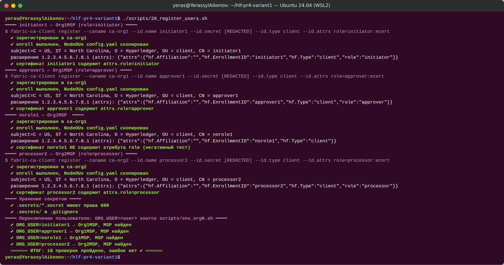

*Рисунок 17 — Выпуск идентичностей с атрибутом role через Fabric CA*

### 4.4. Уязвимая версия `paymentvuln` и её эксплуатация (задания 2.2–2.3)

`chaincode/payment-vuln` — копия v1.0 с **одной** ошибкой: `SubmitPaymentOrder` не проверяет MSP вызывающего (OWASP **SC01** → **SC03**). Diff — 3 строки кода (`evidence/task2/22_vuln_diff.patch`). Развёрнут под отдельным именем: `paymentvuln` 1.0 / sequence 1, та же AND-политика, Package ID `paymentvuln_1.0:18c91489d77e96883040d94bc826f5bc090b162184d8890177d5aee594931268` — sequence основного `payment` не изменился (`evidence/task2/00_precheck.log`, `99_postcheck.log`: 1.0 / 1).

Эксплуатация от имени Org2 (`scripts/21_exploit_vuln.sh`, `evidence/task2/21_exploit.log`):

| # | Операция | От имени | TxID | Блок | Код |
|---|---|---|---|---|---|
| V1 | Create PO-V001 (Org1 **не** авторизует) | Org1MSP/initiator1 | `aec25bf324b0dcc150da24a002902ea9313ffc600b23ba0e7cd963df87aa5bb9` | 21 | VALID |
| **V2** | **Submit PO-V001 — несанкционированная авторизация списания** | **Org2MSP/processor2** | `e4545b3d0965b2b4dfc8c3174c3f58229c1d16c6dd33d6f21c4b110ac6824fe5` | 22 | **VALID** |
| V3 | Accept PO-V001 | Org2MSP/processor2 | `1849dc33a9b343de06e674641168241b30b5ac731e8faf4daecfe3e52eae6f0c` | 23 | VALID |
| V4 | Settle PO-V001 | Org2MSP/processor2 | `cc728cfaf332db86f8b71677b875176870ee089c8bd08a0da5d3bc359232a4dd` | 24 | VALID |

Декодирование блока 22: создатель транзакции Submit — **Org2MSP** (`OU = client, CN = processor2`), endorsements — **Org1MSP и Org2MSP**, код VALID. Итог: PO-V001 = SETTLED, Org1 после создания не выполнила ни одной операции.

**Нарушенные инварианты:** **INV-4** — авторизацию списания (переход в SUBMITTED) выполняет только банк-отправитель (`senderBankMSP` = Org1MSP, роль approver); **INV-SoD** — ни одна организация не может единолично провести платёж от создания до исполнения.

**Почему Endorsement Policy не остановила атаку.** Политика AND была **выполнена**: оба peers исполнили один и тот же ошибочный код, получили одинаковый RW-set и честно подписали результат. EP определяет, *чьи peers* должны подтвердить результат исполнения, но не проверяет, *кто вызвал* функцию. Авторизация вызывающего — ответственность chaincode.

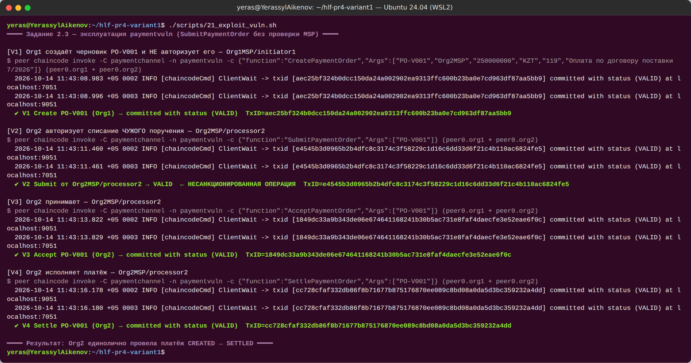

*Рисунок 18 — processor2 (Org2MSP) выполняет Submit → Accept → Settle чужого поручения: все транзакции VALID*

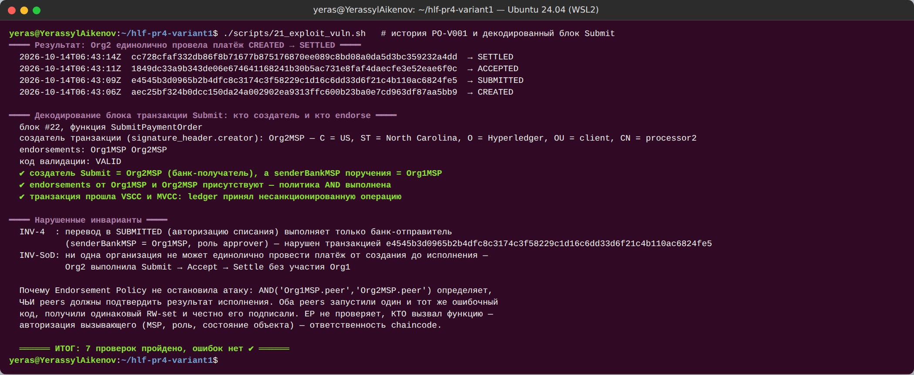

*Рисунок 19 — История PO-V001; в блоке 22 создатель Submit = Org2MSP, endorsements Org1MSP + Org2MSP*

### 4.5. Защищённая версия `paymentsecure` (задание 2.4)

Дизайн — `docs/security/paymentsecure-design.md`. Контроли:

| Механизм | Реализация |
|---|---|
| MSP вызывающего | `GetClientIdentity().GetMSPID()`; Submit/Cancel — только `senderBankMSP`, Accept/Reject/Settle — только `receiverBankMSP` |
| Полномочия пользователя | `AssertAttributeValue("role", …)`: Create/SetSettlementDetails — initiator; Submit — approver; Accept/Reject/Settle — processor |
| Идентичность | `GetID()` → `createdByHash`, `approvedByHash` (sha256); **четыре глаза**: approvedByHash ≠ createdByHash |
| Переходы состояния | таблица `allowedTransitions()`, терминальные статусы |
| Инварианты | INV-1…INV-9 (уникальность, sender = Org1, неизменяемость суммы и сторон, Submit только approver отправителя, четыре глаза, Accept/Reject/Settle только processor получателя, исполнение один раз из ACCEPTED, терминальные статусы, реквизиты обязательны до Submit и неизменны после) |
| Конфиденциальные данные | `GetTransient()` → `PutPrivateData()` / `GetPrivateData()` / `GetPrivateDataHash()` |

Unit-тесты: 37 тестов (каждый инвариант — отдельный тест; матрица авторизации на моках `ClientIdentity` с разными MSP и атрибутами; сквозной тест через `ContractChaincode.Invoke` с реальным разбором атрибута `role` из сертификата), покрытие **96.2 %**, `go vet`/`gosec`/`govulncheck`/`check_determinism` — чисто; 2 стилистических замечания staticcheck обоснованы (`evidence/task2/27_static_analysis_paymentsecure.log`).

**Тот же сценарий атаки на `paymentsecure`** (`evidence/task2/25_exploit_secure.log`): Submit от processor2 → `ERR_UNAUTHORIZED: caller organisation is not allowed to perform this operation`; Accept/Settle → `ERR_INVALID_TRANSITION`; PO-V001 в namespace `paymentsecure` остался CREATED (в `paymentvuln` — SETTLED). Сравнение «до / после» — `docs/security/vuln-vs-secure.md`.

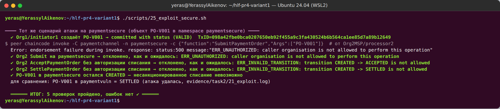

*Рисунок 20 — Тот же Submit от Org2 на paymentsecure: отказ, уязвимость исправлена*

## 5. Private Data Collection и разграничение доступа

### 5.1. Конфигурация коллекции и деплой (задание 2.5)

```json
[{ "name": "collectionSettlementDetails", "policy": "OR('Org1MSP.member')",
   "requiredPeerCount": 0, "maxPeerCount": 1, "blockToLive": 0,
   "memberOnlyRead": true, "memberOnlyWrite": true,
   "endorsementPolicy": { "signaturePolicy": "OR('Org1MSP.peer')" } }]
```

| Поле | Смысл |
|---|---|
| `policy: OR('Org1MSP.member')` | открытые данные хранят только peers Org1; остальные — только хэши |
| `requiredPeerCount: 0`, `maxPeerCount: 1` | распространение по gossip при endorsement не обязательно / максимум 1 peer (у Org1 один peer) |
| `blockToLive: 0` | бессрочное хранение — платёжные документы подлежат хранению в течение установленного законом срока; удаление по числу блоков недопустимо. Альтернатива при регуляторном требовании удаления — ненулевой TTL или `PurgePrivateData` (Fabric 2.5+) |
| `memberOnlyRead / memberOnlyWrite: true` | peer сам отклоняет чтение/запись клиентами не из Org1 |
| `endorsementPolicy: OR('Org1MSP.peer')` | collection-level EP: транзакции, пишущие только в коллекцию, достаточно подписи peer0.org1 |

Деплой `paymentsecure` 1.0 / sequence 1, AND-политика, `--collections-config` одинаково в approve, checkcommitreadiness и commit; Package ID `paymentsecure_1.0:55f18aa731b18cfac745804b7ba3a8666f0c914d1f3e4d59d5a34b0ac446e985`; `querycommitted` показывает коллекцию (`evidence/task2/24_lifecycle_paymentsecure.log`). Совпадение исходников в репозитории с развёрнутым пакетом подтверждено повторным вычислением Package ID.

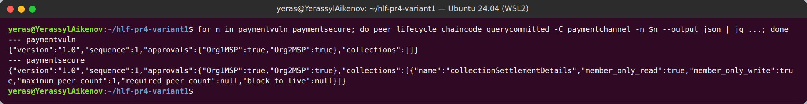

*Рисунок 21 — Определения paymentvuln и paymentsecure (1.0 / 1), коллекция collectionSettlementDetails*

**Дизайн против утечки на этапе Execute.** Если передать реквизиты в той же транзакции, что и публичную запись с AND-политикой, proposal с transient уйдёт на peer Org2, и банк-получатель увидит реквизиты (Information Disclosure, SC01) — этот вариант отвергнут. Принятое решение: `CreatePaymentOrder` — публичная транзакция (AND); `SetSettlementDetails` пишет **только** private-ключи и endorse-ится **только** peer0.org1 (collection EP); chaincode дополнительно отказывается обрабатывать её на peer чужой организации (SEC-17); `SubmitPaymentOrder` проверяет наличие хэша через `GetPrivateDataHash` (доступен и Org2) и фиксирует его в публичном `settlementHash`. Эмпирически: транзакция с одной endorsement получила **VALID**.

### 5.2. Transient и отсутствие реквизитов в публичном Ledger (задание 2.6)

`scripts/23_private_data_flow.sh` (`evidence/task2/23_private_flow.log`, 12 ✔), синтетические, валидные по mod-97 реквизиты (код банка 999, «TEST»):

| # | Операция | TxID | Блок | Endorsers | Код |
|---|---|---|---|---|---|
| S1 | Create PO-S001 (initiator1) | `28a68a396bfa6fc656f2ff85be63588f15d667a95f4523048bc2bd10a623231f` | 25 | Org1 + Org2 | VALID |
| S2 | SetSettlementDetails PO-S001, transient `settlement` | `e3cc9aaad4cb4393e5d47beb15ce3146a3bb25d3adb45a9346b4ea104cf22551` | 26 | **только peer0.org1** | VALID |
| S4 | SetSettlementDetails PO-S002 через **Gateway** (`WithTransient` + `WithEndorsingOrganizations("Org1MSP")`) | `6ef28f98c5e9cd4c5b3b18d166c2182dc8c478f64ce070ab9a816b11a8a8611f` | 28 | только Org1 | VALID |

Доказательства:
1. **Аргументы транзакции** S2 в блоке 26: только `SetSettlementDetails PO-S001`; `TransientMap` в блоке отсутствует.
2. **RW-set:** публичных записей 0; `collection_hashed_rwset` коллекции `collectionSettlementDetails` содержит только `key_hash` и `value_hash`.
3. **`grep -c`** по пяти маркерам (IBAN плательщика и получателя, БИН, наименование, второй IBAN) в сыром блоке `.pb`, в decoded JSON и во всех base64-полях блока — **0**; положительный контроль метода: `grep -c PO-S001` в сыром блоке = 2.
4. **CouchDB:** peer0.org1 — базы `paymentchannel_paymentsecure`, `…$$pcollection$settlement$details` (открытые данные) и `…$$hcollection$settlement$details` (хэши); peer0.org2 — **только `$$h`**. Совпадений маркеров в CouchDB Org2 и в публичной базе Org1 — 0.
5. **Логи** peer0.org1, peer0.org2, orderer и обоих контейнеров chaincode `paymentsecure` — 0 совпадений.
6. `ReadSettlementDetails` от initiator1 на peer0.org1 возвращает реквизиты (в отчёте маскированы: `payerIBAN=KZ**************0001`), соль не возвращается.

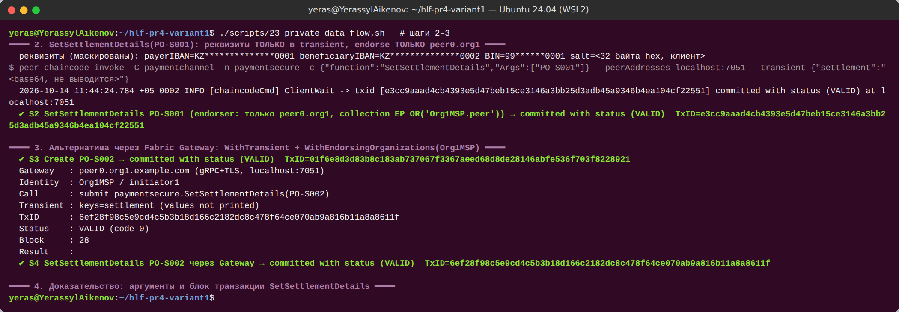

*Рисунок 22 — Реквизиты передаются только в transient (значения не выводятся), endorse только peer0.org1, VALID; вариант через Gateway*

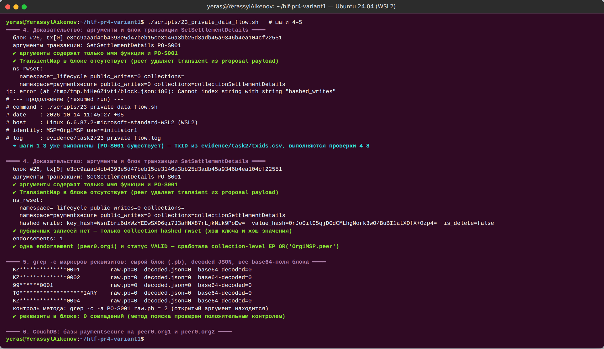

*Рисунок 23 — В блоке только PO-S001 и хэши; поиск реквизитов по блоку — 0 совпадений*

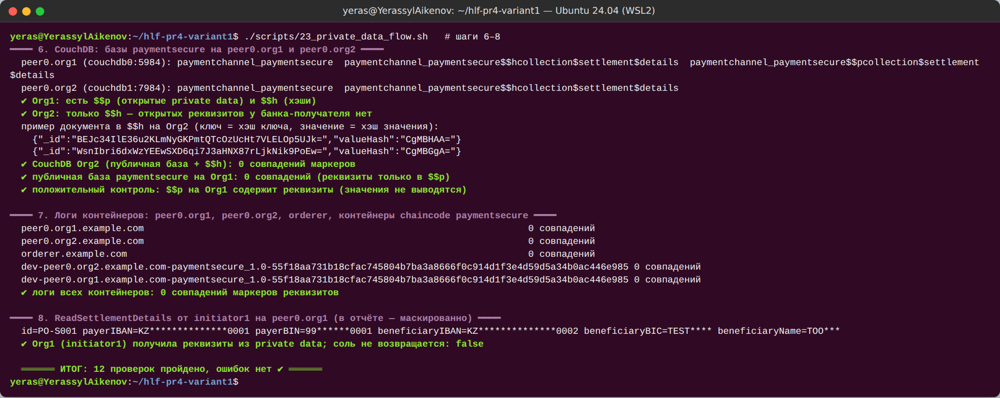

*Рисунок 24 — $$p и $$h на Org1, только $$h на Org2; 0 совпадений в логах контейнеров*

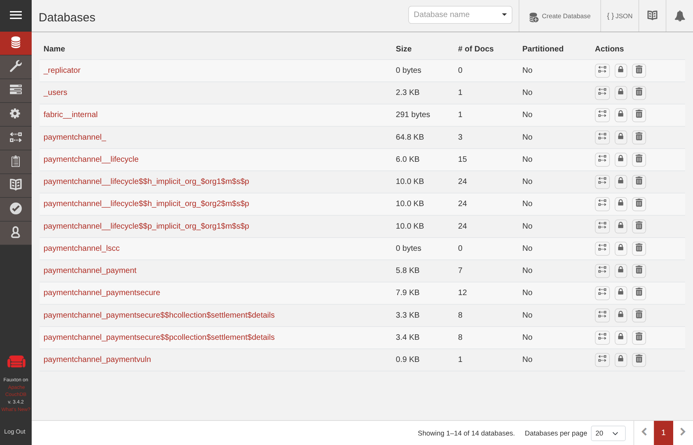

*Рисунок 25 — CouchDB peer0.org1: базы paymentsecure$$p… и $$h…*

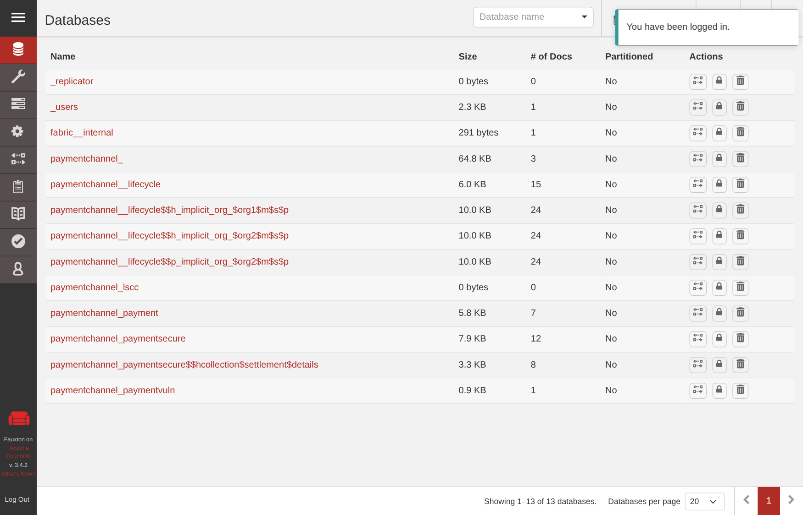

*Рисунок 26 — CouchDB peer0.org2: только paymentsecure$$h… (открытых реквизитов нет)*

### 5.3. Security-тесты (задание 2.7)

`tests/security/run_security_tests.sh` — 17 тестов против живой сети, перезапускаемый (каждый прогон создаёт свои поручения). Результат: **17 PASS, 0 FAIL** (`evidence/task2/security_tests.md`). Org1 имеет доступ к privateDetails (SEC-01), запросы Org2 завершаются отказом (SEC-02, SEC-03).

| ID | OWASP | Сценарий | Ожидание | Факт | Итог |
|---|---|---|---|---|---|
| SEC-01 | SC01 | initiator1 читает реквизиты на peer0.org1 | данные | `payerIBAN=KZ**************0001` | PASS |
| SEC-02 | SC01 | processor2 читает реквизиты на peer0.org2 | отказ | `ERR_UNAUTHORIZED` | PASS |
| SEC-03 | SC01 | processor2 читает реквизиты на peer0.org1 | отказ | `ERR_UNAUTHORIZED` | PASS |
| SEC-04 | SC01/SC03 | повтор эксплойта: Submit от Org2 | отказ | `ERR_UNAUTHORIZED` | PASS |
| SEC-05 | SC01/SC03 | initiator1 сам авторизует (нет роли approver, 4 глаза) | отказ | `ERR_UNAUTHORIZED: caller role is not permitted` | PASS |
| SEC-06 | SC01 | norole1 создаёт поручение | отказ | `ERR_UNAUTHORIZED` | PASS |
| SEC-07 | SC03 | Settle из SUBMITTED в обход ACCEPTED | отказ | `ERR_INVALID_TRANSITION` | PASS |
| SEC-08 | SC03 | повторный Settle (replay) | отказ | `ERR_INVALID_TRANSITION: SETTLED -> SETTLED` | PASS |
| SEC-09 | SC03 | Create с существующим ID | отказ | `ERR_ALREADY_EXISTS` | PASS |
| SEC-10 | SC04/SC08 | сумма −1, 0, 2⁶³, 1e3; валюта XXX; IBAN с ошибкой mod-97 | отказ каждого | 6 из 6 отклонены | PASS |
| SEC-11 | SC04/SC10 | без transient / > 4 КБ / короткая соль / лишнее поле | отказ | 4 из 4 отклонены | PASS |
| SEC-12 | SC03 | SetSettlementDetails после SUBMITTED (INV-9) | отказ | `ERR_INVALID_TRANSITION` | PASS |
| SEC-13 | SC01 | Verify от Org2: верный кандидат / неверный | true / false | `match=true` / `match=false` | PASS |
| SEC-14 | SC10 | GetAllPaymentOrders pageSize = 10000 | отказ | `ERR_VALIDATION: pageSize must be in range 1..50` | PASS |
| SEC-15 | SC01 | маркеры реквизитов во всех блоках, CouchDB Org2, логах | 0 | блоки=0, couchdb1=0, логи=0 | PASS |
| SEC-16 | SC03 | Submit без реквизитов (INV-9) | отказ | `ERR_VALIDATION: settlement details must be set` | PASS |
| SEC-17 | SC01 | SetSettlementDetails отправлен на peer0.org2 | отказ | `ERR_UNAUTHORIZED: client organisation does not match the peer organisation` | PASS |

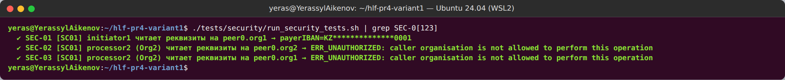

*Рисунок 27 — Org1 читает privateDetails (маскировано), Org2 получает отказ на своём и на чужом peer*

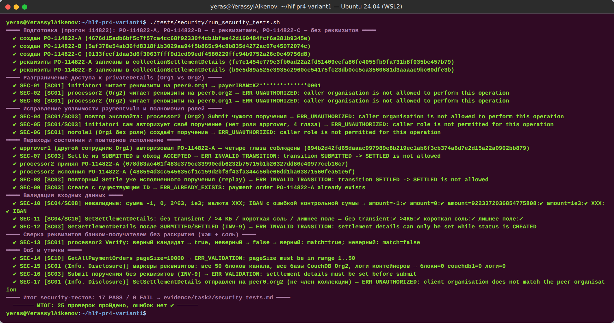

*Рисунок 28 — 17 security-тестов: 17 PASS*

**Выводы по заданию 2.** Уязвимость отсутствия авторизации воспроизведена практически и проходит Endorsement Policy; исправление (MSP + роль + четыре глаза + инварианты) подтверждено тем же сценарием атаки и 17 тестами. Конфиденциальные реквизиты не попадают ни в аргументы, ни в публичную часть ledger, ни к банку-получателю; Org2 может только сверить их хэш с солью. Основной chaincode `payment` всё это время оставался 1.0 / sequence 1.


## 6. Обновление chaincode 1.0 → 2.0 (sequence 1 → 2)

### 6.1. Исходное состояние (задание 3.1)

`scripts/30_pre_upgrade_snapshot.sh` → `evidence/task3/30_pre_upgrade/` (11 ✔): `querycommitted` — **Version 1.0, Sequence 1**, политика AND, approvals обеих организаций; Package ID на обоих peers `payment_1.0:41e4157887f433f851ad7fcb43f449aff92a55a8a0f855676c5319d3e6769748`; состояние объектов: PO-0001 SETTLED, PO-0002 CANCELLED, PO-0003 CREATED; полный снимок `GetAllPaymentOrders` → `state_v1.json` (ключи упорядочены `jq -S`), **sha256 `69f0ea3b7778c52a39e44802cca560a0d3839253af992d9da08f9e4b5bf7e480`**; высота канала до обновления — 51. Реальный JSON PO-0001 и PO-0003 сохранён как golden-фикстуры для unit-тестов v2.0.


*Рисунок 29 — Исходное состояние: payment 1.0 / 1, Package ID, статусы объектов*

### 6.2. Chaincode 2.0 и совместимость с World State (задание 3.2)

`chaincode/payment-v2` — эволюция v1.0 (тот же namespace `payment`). Правила совместимости (`docs/upgrade/payment-v2-compat.md`): (1) формат ключей `PO-…` не меняется; (2) JSON-поля v1.0 не переименовываются, не удаляются, не меняют тип; (3) новые поля только `omitempty` + `metadata:",optional"`; (4) **ленивая миграция** — объект без `schemaVersion` читается как версия 1, первая запись через v2.0 ставит `schemaVersion: 2`, массовой миграции в `Init` и `--init-required` нет; (5) статусы и переходы только добавляются; (6) сигнатуры функций v1.0 не меняются.

Новая функциональность: `ReturnPaymentOrder(id, reasonCode)` — возврат исполненного платежа банком-получателем (SETTLED → **RETURNED**, терминальный, не более одного раза); `SetValueDate(id, date)` — дата валютирования (только отправитель, только CREATED; сигнатура Create не меняется); `GetPaymentOrdersByStatus(status, pageSize, bookmark)` — rich query CouchDB по индексу `META-INF/statedb/couchdb/indexes/indexStatus.json`. Новые поля: `schemaVersion`, `valueDate`, `returnReason`, `returnedAt`.

OWASP-ревью обновления (`docs/upgrade/owasp-upgrade-review.md`): SC01 — Return только получатель, SetValueDate только отправитель; SC03 — RETURNED нельзя повторить и нельзя попасть в него в обход SETTLED; SC04 — reasonCode, строгая календарная дата, статус из белого списка, селектор строится `json.Marshal` (инъекция `{"$gt":null}` отклонена); SC09 — rich query только в evaluate, результат не используется для записи (rich queries не перепроверяются на phantom reads); SC10 — pageSize 1..50, индекс.

Тесты: 76 (все 70 тестов v1.0 — файлы скопированы **без изменений** и проходят; golden-фикстуры v1; ленивая миграция; новые функции, включая негативные), покрытие **96.5 %**, `go vet`/`staticcheck`/`gosec`/`govulncheck`/`check_determinism` — 0 находок (`evidence/task3/32_static_analysis_payment_v2.log`).

**Package ID 2.0:** `payment_2.0:14d12cad119b7bfa2cc2cca4fda861db6321eb84ffd356ca863e32c682247c6c`.

### 6.3. Установка, утверждение, commit (задания 3.3–3.5)

| Этап | Результат | Доказательство |
|---|---|---|
| Install на peer0.org1 и peer0.org2 | `queryinstalled` на обоих peers показывает **оба** пакета: `payment_1.0:41e41578…` и `payment_2.0:14d12cad…`. Установка сама по себе ничего не меняет в канале — код исполняется только после commit нового определения | `33_install_payment_2.0.log`, рисунок 30 |
| approveformyorg Org1 → readiness | `Org1MSP: true, Org2MSP: false` | `34_approve_payment_2.0.log` |
| approveformyorg Org2 → readiness | `Org1MSP: true, Org2MSP: true` | рисунок 31 |
| Негатив: approve с `--sequence 3` | `requested sequence 3 is larger than the next available sequence number 2` | `34_negative_lifecycle.log`, рисунок 32 |
| Негатив: readiness с политикой OR / без политики | approvals `false / false` — это другое определение; пропуск `--signature-policy` молча сменил бы модель доверия на политику канала по умолчанию | рисунок 32 |
| Commit (оба peers) → querycommitted | **Version 2.0, Sequence 2**, `validation_parameter` идентичен 1.0 (AND), approvals обеих организаций | `35_commit.log`, рисунок 33 |
| Первое обращение | запущены `dev-peer0.org1/org2…-payment_2.0-14d12cad…`, контейнеры 1.0 остановлены | рисунок 33 |

| Параметр | До | После |
|---|---|---|
| Version | 1.0 | **2.0** |
| Sequence | 1 | **2** |
| Package ID | `payment_1.0:41e41578…9748` | `payment_2.0:14d12cad…7c6c` |
| Endorsement Policy | AND('Org1MSP.peer','Org2MSP.peer') | без изменений |


*Рисунок 30 — На каждом peer установлены payment 1.0 и 2.0 (а также paymentvuln, paymentsecure)*


*Рисунок 31 — Утверждение определения 2.0 / 2 организациями*


*Рисунок 32 — Отказ при sequence 3 и несовпадение определения при другой политике*


*Рисунок 33 — Version 2.0, Sequence 2; запущены контейнеры payment_2.0*

### 6.4. Проверка обратной совместимости (задание 3.6)

`scripts/36_compat_check.sh` (`evidence/task3/36_compat.log`, 19 ✔, `compat_table.md`):

| Проверка | Действие через v2.0 | Результат | TxID / блок |
|---|---|---|---|
| C1 | `ReadPaymentOrder(PO-0001)`, созданного и исполненного v1.0 | JSON **идентичен** снимку v1 (diff пуст), `schemaVersion` отсутствует → версия 1 | — |
| C2 | `GetAllPaymentOrders` → `state_after.json` | **sha256 = `69f0ea3b…e480`** — совпадает со `state_v1.json` | — |
| C3 | старые операции Submit → Accept → Settle над PO-0003 (создан v1.0) | VALID ×3, после записи `schemaVersion: 2` | `7aeadc74…ef04` (54), `25cd07a4…6127` (55), `bb508e5e…ac39` (56) |
| C4 | новая функция `ReturnPaymentOrder(PO-0001)` | VALID, RETURNED, `returnReason=ACCOUNT_CLOSED` | `eb1cf454ae93377ee7533c61132014f1631727a9767be233dbb54d1a71a06395` (57) |
| C5 | повторный Return PO-0001 | отказ `ERR_INVALID_TRANSITION: RETURNED -> RETURNED` | — |
| C6 | `GetPaymentOrdersByStatus("SETTLED")` | найден PO-0003 | — |
| C7 | новый PO-0006: Create, SetValueDate, Submit, Accept, Settle | VALID ×5 | `4263c8bc…`(58) … `72a38c3f…`(62) |
| C8 | `GetPaymentOrderHistory(PO-0001)` | в одной истории T1–T4 (v1.0, без `schemaVersion`) и C4 Return (v2.0, `schemaVersion=2`) | — |
| C9 | Return от Org1 | отказ `ERR_UNAUTHORIZED` (SC01) | — |

**Вывод.** World State принадлежит namespace chaincode (`payment` в канале), а не пакету: при смене пакета данные остаются на месте, и новая реализация читает их благодаря правилам совместимости.


*Рисунок 34 — Объект v1.0 читается через v2.0 без изменений; хэш состояния до и после смены пакета совпадает*


*Рисунок 35 — Старая операция над объектом v1.0, новая функция Return, история с TxID обеих версий*


*Рисунок 36 — Итоговая таблица C1–C9: все PASS*

### 6.5. План обновления инфраструктуры Fabric 2.5 → 3.1.x

Полный план — `docs/upgrade/fabric-2.5-to-3.1-plan.md` (со ссылками на `upgrade`, `upgrade_to_newest_version`, `upgrading_your_components`, `updating_capabilities`, release notes). Кратко, по последовательности **Backup → Orderers → Peers → Verification → Channel Capabilities**:

0. **Предусловия:** нет system channel (Channel Participation API — у нас `systemChannel: null`); нет Solo и Kafka (удалены в 3.0; у нас etcdraft); нет legacy lifecycle (удалён в 3.0; Application capability V2_5, все chaincode в `_lifecycle`); `OrdererEndpoints` на уровне организаций; ревизия `core.yaml`/`orderer.yaml`; сборка chaincode в `fabric-ccenv:3.1.5` (Go 1.26.4); CouchDB; клиенты на Fabric Gateway.
1. **Backup:** ledger `/var/hyperledger/production`, MSP/TLS, конфиги, БД Fabric CA, CouchDB (бэкап CouchDB старше бэкапа peer); останов → копия → sha256 → шифрование → проверка восстановимости.
2. **Orderers:** по одному (rolling), после каждого — проверка кворума Raft, лидера и высот (`osnadmin`).
3. **Peers:** по одному на организацию, вместе со своим CouchDB; удаление контейнеров и образов chaincode (пересоберутся в новом ccenv).
4. **Verification:** версии, равные высоты и `currentBlockHash`, `querycommitted`, тестовая транзакция через Gateway, логи без ошибок.
5. **Channel Capabilities `V3_0`:** только после обновления всех узлов; config update (fetch → decode → правка → `compute_update` → подписи Admins по политике → submit). **Точка невозврата** — откат бинарников на 2.5 после V3_0 невозможен.

Также: план отката по этапам, матрица рисков, окно обслуживания и критерии Go/No-Go.

**Практическое подтверждение этапа Backup** (`scripts/38_backup_volumes.sh`, `evidence/task3/38_backup.log`, 17 ✔): узлы остановлены, CouchDB заархивирован раньше ledger, архивы томов orderer/peers, `organizations/` и `channel-artifacts/` зашифрованы AES-256-CBC (PBKDF2, ключ только в `.secrets/`), посчитаны sha256; после запуска высота 64 и `currentBlockHash` не изменились; каждый архив расшифрован и сверен. **Восстановимость доказана на практике:** после стенда SmartBFT основная сеть восстановлена из этого бэкапа (`scripts/40_restore_main.sh`, 13 ✔) — высота 64 и `currentBlockHash pvthqFOPl0vrLbxyVbdhyfPTTARJGfZmGXeHcT+HKrA=` совпали с моментом бэкапа, история PO-0001 содержит исходные TxID.


*Рисунок 37 — Консистентный зашифрованный бэкап и проверка восстановимости*

## 7. SmartBFT и итоговый вывод

### 7.1. Стенд (задание 3.7)

Основная сеть остановлена после бэкапа и подтверждения пользователя; стенд поднят командой `./network.sh up createChannel -bft -c bftchannel -ca -s couchdb` (флаг `-bft` совместим с `-ca` — `registerEnroll.sh` выпускает идентичности orderer…orderer4 — и с `-s couchdb`). Конфигурация канала (`evidence/task3/bft/39_bft_config.log`): **ConsensusType = BFT**, channel capability **V3_0**, 4 consenter-а (OrdererMSP):

| ID | Orderer | Порт | Admin (osnadmin) | Operations |
|---|---|---|---|---|
| 1 | orderer.example.com | 7050 | 7053 | 9443 |
| 2 | orderer2.example.com | 7052 | 7055 | 9446 |
| 3 | orderer3.example.com | 7056 | 7057 | 9447 |
| 4 | orderer4.example.com | 7058 | 7059 | 9448 |

Параметры SmartBFT: `request_batch_max_count 100`, `request_batch_max_interval 50ms`, `request_forward_timeout 2s`, `request_complain_timeout 20s`, `view_change_timeout 20s`, `leader_heartbeat_timeout 1m0s`, `leader_rotation ROTATION_UNSPECIFIED`. В `bftchannel` развёрнут `payment` 2.0 (AND-политика) — Package ID совпал с основной сетью (`14d12cad…`), что подтверждает детерминированность упаковки. Лист 3 схемы сверен и дополнен портами.


*Рисунок 38 — Стенд SmartBFT (лист 3 схемы) и сравнение Raft / SmartBFT*


*Рисунок 39 — 4 orderer, 2 peer, 3 Fabric CA, 2 CouchDB*


*Рисунок 40 — ConsensusType BFT, consenters, параметры SmartBFT, V3_0, лидер текущего view*

### 7.2. Эксперимент

`scripts/39_bft_experiment.sh` (`evidence/task3/bft/39_bft_experiment.log`, 13 ✔, `experiment.md`). Лидер определяется по последней строке `ChangeRole` в логах orderer, высоты — `osnadmin channel list` на admin-порту каждого orderer и `peer channel getinfo` на каждом peer. Прогон 1 (`*_run1.*`) дал те же результаты; ниже — финальный прогон 2.

| Шаг | Действие | Живые | Кворум | Результат | TxID | Высоты (o1/o2/o3/o4/p1/p2) |
|---|---|---|---|---|---|---|
| E1 | базовая транзакция | 4/4 | да | VALID | `c352d132…eff9` | 12/12/12/12/12/12 |
| E2 | `docker stop orderer4` (не лидер) | 3/4 | да (3 ≥ 3) | — | — | 12/12/12/—/12/12 |
| E3 | **контрольная транзакция при n − 1** | 3/4 | да | **VALID** | `421a1005524b5157a406370d1b32d0976e8eb941c199b9e5a39a790596b48097` | 13/13/13/—/13/13 |
| E4 | `docker start orderer4` → catch-up, транзакция | 4/4 | да | VALID | `833f7a41…4b7b` | 14/14/14/14/14/14 |
| E5 | стоп **лидера** (orderer3, view 2) → view change, транзакция через orderer2 | 3/4 | да | VALID за 55.5 с | `d4c4aecb…e42c` | 15/15/—/15/15/15 |
| E6 | `docker start orderer3` → catch-up | 4/4 | да | — | — | 15/15/15/15/15/15 |
| E7 | стоп **двух** orderer (orderer3, orderer) | 2/4 | **нет** (2 < 3) | блок не сформирован, таймаут 40 с | позже `51db99ec…646e` | —/15/—/15/15/15 |
| E8 | старт обоих → транзакция | 4/4 | да | VALID за 63 с | `6093a49f…bf9c` | 16/16/16/16/16/16 |

Наблюдения по логам:
- **Отказ не-лидера (E2–E3):** живые узлы фиксируют недоступность (`sendMessage … to orderer4(orderer4.example.com:7058)`), консенсус продолжается на 3 узлах — ровно кворум.
- **Catch-up (E4):** перезапущенный orderer4 не догоняет канал «сам по себе» — синхронизация (`detectTargetHeight -> Detected target height: 14`) происходит при следующем раунде консенсуса; после транзакции E4 высоты всех 6 узлов равны.
- **Отказ лидера (E5):** запрос к follower-у не упорядочивается → `OnRequestTimeout` / `OnLeaderFwdRequestTimeout` (таймауты 2 с и 20 с) → жалобы follower-ов → **view change** → `Changing to leader role, current view: 3, current leader: 4`; транзакция зафиксирована через ≈ 56 с после остановки лидера.
- **Нет кворума (E7):** блок не формируется, высоты не растут, клиент получает таймаут ожидания. Транзакция при этом **не потеряна**: она осталась в request pool и после восстановления кворума упорядочена в блок 15 вместе с E8 (VALID). Блок 15 подписан **тремя** orderer-ами (metadata SIGNATURES = 3 ≥ кворума; в Raft-канале — 1 подпись).


*Рисунок 41 — E1–E3: отказ не-лидера и контрольная транзакция VALID на высоте H+1*


*Рисунок 42 — E4: docker start orderer4, синхронизация, высоты всех узлов равны*


*Рисунок 43 — E5–E6: остановка лидера, view change, новая транзакция VALID*


*Рисунок 44 — E7–E8: два узла остановлены — блок не формируется; после восстановления транзакция упорядочена, блок подписан 3 consenter-ами*


*Рисунок 45 — Сводная таблица эксперимента SmartBFT*


*Рисунок 46 — Итоговые высоты: все 4 orderer и оба peers на высоте 16, одинаковый currentBlockHash*

### 7.3. Анализ: crash fault vs Byzantine fault

**Арифметика.** n = 3f + 1 = 4 ⇒ f = 1; кворум q = ⌈(n + f + 1)/2⌉ = ⌈6/2⌉ = 3. При одном отказе остаётся 3 = q (E3, E5 — работа продолжается), при двух — 2 < q (E7 — блок не формируется). Любые два кворума по 3 из 4 пересекаются минимум в 2 узлах, из которых хотя бы один честный при f = 1, — поэтому два конфликтующих блока одной высоты не могут быть подписаны.

**Почему `docker stop` доказывает только устойчивость к crash.** Остановленный контейнер просто **молчит**: не отвечает, не подписывает, не рассылает сообщений. Византийский узел может вести себя произвольно: рассылать разным узлам противоречивые предложения (equivocation), подписывать конфликтующие блоки, предлагать некорректные блоки, будучи лидером, цензурировать или переупорядочивать транзакции, выборочно задерживать доставку, отправлять корректные по формату, но ложные сообщения view change. Эксперимент не создаёт ни одной из этих ситуаций, поэтому подтверждает только, что протокол переживает «молчащий» узел и смену лидера.

**Что потребовалось бы для проверки BFT:** модифицированный orderer с внедрением ошибок (equivocation, подпись конфликтующих предложений, задержка/искажение сообщений протокола), сетевые разбиения и задержки (`tc netem`, `iptables`) между конкретными парами узлов, лидер, цензурирующий транзакции одной организации, проверка обнаружения и view change в этих условиях; для гарантий — формальная верификация протокола (TLA+, модель-чекинг) и аудит реализации библиотеки SmartBFT.

**Сравнение с Raft основной сети.** Основная сеть использует Raft с **одним** orderer: его остановка означает полную остановку упорядочивания (n = 1 ⇒ f = 0). Raft (CFT, n = 2f + 1) переживает отказ меньшинства узлов, но доверяет лидеру: злонамеренный лидер может цензурировать или переставлять транзакции, а блок подписывает один узел. SmartBFT (BFT, n = 3f + 1) проверяет предложения лидера, требует подписей кворума (3 подписи в блоке 15) и заменяет подозрительного лидера через view change, но платит за это числом узлов (4 вместо 3 для f = 1), задержками (≈ 55 с на смену лидера при настройках по умолчанию) и пропускной способностью. Выбор — по модели доверия: Raft, если orderer-ы принадлежат одному оператору или взаимно доверяющим сторонам; SmartBFT — если узлы упорядочивания распределены между банками без взаимного доверия.

### 7.4. Итоговый вывод по работе

**Что получилось.** Развёрнута корпоративная сеть Fabric 3.1.5 с Fabric CA и CouchDB; chaincode `payment` с state machine, валидацией и AND-политикой выполнен в 9 VALID-транзакциях с реальными TxID, транзакция T4 разобрана по пяти этапам из реального блока, проверена хэш-цепочка ledger и продемонстрирован `MVCC_READ_CONFLICT`. Построена модель угроз (15 угроз STRIDE/DREAD), уязвимость отсутствия авторизации воспроизведена от имени Org2 и устранена в `paymentsecure` (MSP + роль + четыре глаза + инварианты); расчётные реквизиты изолированы в PDC и доказуемо отсутствуют в публичной части ledger и у Org2; 17/17 security-тестов. Выполнено обновление `payment` 1.0/1 → 2.0/2 с побайтным сохранением состояния (sha256), разработан план обновления 2.5 → 3.1.x и практически проверены его этапы Backup и восстановление; эксперимент SmartBFT подтвердил устойчивость к отказу одного orderer и потере лидера и показал остановку при потере кворума.

**Ограничения.** Стенд — одна машина, по одному peer на организацию, Raft с одним orderer в основной сети; секреты test-network (bootstrap-пароли CA, CouchDB) — по умолчанию; ключи на диске, а не в HSM; эксперимент BFT проверяет только crash faults.

**Что улучшить для production:** HSM/PKCS#11 для ключей, отдельные TLS CA, mTLS для клиентов; несколько peers на организацию и ≥ 3 orderer у разных операторов (или SmartBFT при отсутствии доверия); state-based endorsement для отдельных поручений; `PurgePrivateData` по регламенту хранения; мониторинг (operations endpoints, Prometheus), централизованный сбор логов с маскированием; регулярные учения по восстановлению из бэкапа; CI с unit/security-тестами, gosec/govulncheck и проверкой детерминизма для каждого изменения chaincode.


## Приложение А. Структура репозитория и воспроизведение

```
hlf-pr4-variant1/
├── CLAUDE.md, README.md, .gitignore
├── chaincode/payment-v1 | payment-vuln | payment-secure | payment-v2   # Go chaincode + unit-тесты
├── client/                      # Go-клиент Fabric Gateway (payment-client)
├── collections/collections_config.json
├── scripts/                     # все шаги: 00…40, lifecycle.sh, analyze_tx.sh, demo.sh, demo_bft.sh, lib.sh, redact.sh
├── tests/security/run_security_tests.sh
├── evidence/task1|task2|task3|final/   # логи после redaction, txids.csv, таблицы
└── docs/architecture | chaincode | security | upgrade | report
```

Воспроизведение с нуля (WSL2 Ubuntu, Docker, Go): `scripts/00_check_env.sh` → `01_install_fabric.sh` → `02_network_up.sh` → `04_cli_env_org1.sh` → `07_static_analysis.sh` → `lifecycle.sh -n payment -p chaincode/payment-v1 -v 1.0 -s 1` → `10_transactions.sh` → `10b_mvcc_demo.sh` → `analyze_tx.sh <T4>` → `12_state.sh` → `13_ledger_info.sh` → `20_register_users.sh` → `lifecycle.sh` для `paymentvuln` и `paymentsecure` (`-c collections/collections_config.json`) → `21_exploit_vuln.sh` → `23_private_data_flow.sh` → `25_exploit_secure.sh` → `tests/security/run_security_tests.sh` → `30_pre_upgrade_snapshot.sh` → `lifecycle.sh … -v 2.0 -s 2 --stop-before-commit` → `34_negative_lifecycle.sh` → `35_commit_v2.sh` → `36_compat_check.sh` → `38_backup_volumes.sh` → `39_bft_up.sh` → `39_bft_config.sh` → `lifecycle.sh … -C bftchannel` → `39_bft_experiment.sh` → `40_restore_main.sh`. Демонстрация на защите: `scripts/demo.sh` (≈ 2–3 мин, 37 проверок), `scripts/demo.sh --full`, `scripts/demo_bft.sh`.

## Приложение Б. Индекс доказательств

| Раздел отчёта | Файл в `evidence/` | Скриншот |
|---|---|---|
| 1 Среда, версии | `task1/00_check_env.log`, `task1/01_versions.log` | — |
| 2.1 Сеть | `task1/02_network_up.log` | рис. 1 |
| 2.3 CLI Org1 | `task1/04_cli_env_org1.log` | рис. 4, 5 |
| 3.1 Тесты и анализ v1.0 | `task1/07_static_analysis.log`, `task1/attempt1/` | рис. 6 |
| 3.2 Деплой 1.0/1 | `task1/08_lifecycle_payment_1.0.log` | рис. 7, 8 |
| 3.3 Транзакции, MVCC | `task1/10_transactions.log`, `task1/10b_mvcc_demo.log`, `task1/txids.csv` | рис. 9–12 |
| 3.4 Разбор T4 | `task1/11_analyze_tx_6d535b17ed87.log`, `task1/tx_anatomy_6d535b17….md` | рис. 13 |
| 3.5 Состояние | `task1/12_state.log`, `task1/state_table.md` | рис. 14, 15 |
| 3.6 Ledger | `task1/13_ledger_info.log`, `task1/13_newest_block_decoded_fragment.json` | рис. 16 |
| 4.3 Пользователи | `task2/20_register_users.log`, `task2/20b_rotate_secrets.log` | рис. 17 |
| 4.4 Уязвимость | `task2/22_vuln_diff.patch`, `task2/22_lifecycle_paymentvuln.log`, `task2/21_exploit.log`, `task2/txids.csv` | рис. 18, 19 |
| 4.5 Защита | `task2/27_static_analysis_paymentsecure.log`, `task2/25_exploit_secure.log` | рис. 20 |
| 5.1 PDC, деплой | `task2/24_lifecycle_paymentsecure.log` | рис. 21 |
| 5.2 Transient | `task2/23_private_flow.log`, `task2/23_setsettlement_block_decoded.json` | рис. 22–26 |
| 5.3 Security-тесты | `task2/security_tests.log`, `task2/security_tests.md` | рис. 27, 28 |
| sequence `payment` не менялся | `task2/00_precheck.log`, `task2/99_postcheck.log` | — |
| 6.1 Снимок | `task3/30_pre_upgrade_snapshot.log`, `task3/30_pre_upgrade/` | рис. 29 |
| 6.2 v2.0 | `task3/32_static_analysis_payment_v2.log` | — |
| 6.3 Lifecycle 2.0/2 | `task3/33_install_payment_2.0.log`, `task3/34_approve_payment_2.0.log`, `task3/34_negative_lifecycle.log`, `task3/35_commit.log` | рис. 30–33 |
| 6.4 Совместимость | `task3/36_compat.log`, `task3/compat_table.md`, `task3/state_after.json`, `task3/txids.csv` | рис. 34–36 |
| 6.5 Backup / restore | `task3/38_backup.log`, `task3/40_restore_main.log` | рис. 37 |
| 7 SmartBFT | `task3/bft/39_bft_up.log`, `39_bft_config.log`, `39_bft_lifecycle_payment.log`, `39_bft_experiment.log`, `experiment.md`, `*_run1.*` | рис. 38–46 |
| Итоговые проверки | `final/scan_secrets.log`, `final/verify_report_facts.log`, `final/completeness.md` | — |

## Приложение В. Ответы на контрольные вопросы

### 1. Жизненный цикл транзакции Execute → Order → Validate → Commit; где транзакция может стать недействительной; роль MVCC

**Execute.** Клиент формирует proposal (канал, chaincode, функция, аргументы, при необходимости transient), подписывает его своим X.509 и отправляет в Fabric Gateway. TxID вычисляется как SHA-256(nonce ‖ creator) — в разборе T4 он пересчитан и совпал. Gateway отправляет proposal endorsing-peers, достаточным для Endorsement Policy (у нас AND — peer0.org1 и peer0.org2). Peer проверяет подпись и права клиента, запускает chaincode в симуляции: ledger не меняется, формируется RW-set — Read Set (ключи с версиями «блок/транзакция», у T4 — `PO-0001` версии 8/0) и Write Set. Peer подписывает ответ (endorsement). На этом этапе транзакция может быть **отклонена ещё до ledger**: ошибка chaincode (N1 — `ERR_INVALID_TRANSITION`, N2 — `ERR_UNAUTHORIZED`), отказ в доступе, несовпадение ответов endorsers, невозможность собрать политику. Такие транзакции вообще не попадают в блоки — у N1/N2 нет TxID в ledger.

**Order.** Клиент подписывает транзакцию с endorsements, Gateway отправляет её в Ordering Service. Orderer **не исполняет** chaincode и не проверяет бизнес-логику; он проверяет право отправителя писать в канал (политика Writers), формат и размер, упорядочивает транзакции, формирует блок (BatchSize/BatchTimeout), подписывает его и доставляет peers. Эксперимент показал: копия блока у orderer не содержит `TRANSACTIONS_FILTER` — валидация ещё не выполнена.

**Validate.** Каждый peer независимо проверяет каждую транзакцию блока: подписи, VSCC — удовлетворяет ли набор endorsements политике (иначе `ENDORSEMENT_POLICY_FAILURE`), дубликат TxID (`DUPLICATE_TXID`), и **MVCC**: совпадает ли версия каждого ключа из Read Set с текущей версией в World State. Если ключ изменила более ранняя транзакция того же или предыдущего блока — `MVCC_READ_CONFLICT`; для range-запросов — `PHANTOM_READ_CONFLICT`.

**Commit.** Блок **целиком**, включая невалидные транзакции с кодами в `TRANSACTIONS_FILTER`, дописывается в Blockchain; к World State применяются write-set только валидных транзакций; обновляется History DB; клиент получает статус через Gateway.

**Роль MVCC.** Это оптимистичная конкурентность без блокировок: симуляция идёт параллельно, а конфликт обнаруживается при валидации. Она защищает от lost update и двойного исполнения. Наш пример: M1 (Submit) и M2 (Cancel) PO-0005 были endorse-ены по одной версии ключа, упорядочены в блок 14; M2 применена (VALID), M1 получила `MVCC_READ_CONFLICT` — она лежит в блоке, но PO-0005 остался CANCELLED с `lastTxId` M2. Без MVCC обе транзакции «перезаписали» бы друг друга, и итог зависел бы от порядка применения.

### 2. Endorsement Policy vs авторизация в chaincode; может ли транзакция удовлетворять EP и нарушать бизнес-логику

Endorsement Policy — правило уровня канала, определяющее, **чьи peers** должны подтвердить результат исполнения chaincode, чтобы транзакция считалась валидной. Она проверяется на этапе Validate (VSCC) и отвечает на вопрос «согласны ли нужные организации, что этот код при этом состоянии даёт этот RW-set». EP ничего не знает о вызывающем пользователе, его роли и о бизнес-правилах: она защищает от того, что одна организация подделает результат исполнения, но не от того, что сам код разрешает недопустимое действие.

Авторизация вызывающего — ответственность chaincode: проверка MSP (`GetMSPID`), атрибутов (`AssertAttributeValue("role", …)`), идентичности (`GetID` — например, принцип четырёх глаз), текущего состояния объекта и допустимости перехода.

**Да, транзакция может удовлетворять EP и нарушать бизнес-логику** — это доказано практически. В `paymentvuln` функция Submit не проверяла MSP. Сотрудник банка-получателя `processor2` (Org2MSP) выполнил Submit чужого поручения PO-V001: транзакция `e4545b3d…4fe5` в блоке 22 имеет создателя Org2MSP, endorsements **Org1MSP и Org2MSP** и код **VALID**. Затем Org2 сама выполнила Accept и Settle — платёж исполнен без авторизации банка-отправителя. Политика AND была выполнена честно: оба peers исполнили один и тот же ошибочный код, получили одинаковый RW-set и подписали его. Нарушены инварианты INV-4 (авторизует списание только approver банка-отправителя) и INV-SoD (ни одна организация не проводит платёж единолично) — это OWASP SC01 (Access Control) с последствием SC03 (Logic Errors).

В `paymentsecure` тот же вызов отклонён на этапе endorsement: `ERR_UNAUTHORIZED: caller organisation is not allowed to perform this operation` (SEC-04, `25_exploit_secure.log`). Дополнительный механизм Fabric — **state-based endorsement** (`SetStateValidationParameter`): для конкретного ключа можно задать собственную политику, например требовать подписи только организации-владельца. Но и он определяет подписантов результата, а не права вызывающего, поэтому проверки в chaincode остаются обязательными.

### 3. Channel vs Private Data Collection

**Изоляция участников.** Channel — отдельная «подсеть» со своим членством и конфигурацией: организации вне канала не знают ни о транзакциях, ни даже о факте отношений участников. PDC существует **внутри** канала: все участники канала видят, что транзакция была, и видят хэши private data; открытые значения получают только члены коллекции (у нас — `OR('Org1MSP.member')`).

**Хранение и ledger.** У канала свой Blockchain и World State на каждом peer-участнике. Private data хранятся в отдельной БД только у peers-членов (`$$p`-база в CouchDB peer0.org1 и pvtdata store); в блоках канала и у остальных peers — только хэши ключа и значения (`collection_hashed_rwset`, `$$h`-база на peer0.org2). Orderer видит все транзакции канала целиком, но для private data — только хэши. Передача: через transient в proposal и gossip между членами (`requiredPeerCount`, `maxPeerCount`); срок жизни — `blockToLive`, удаление — `PurgePrivateData`.

**Политики доступа.** Канал: политики Readers/Writers/Admins, LifecycleEndorsement, Endorsement Policy chaincode. PDC: `policy` членства, `memberOnlyRead/Write` (peer сам отклоняет чужих клиентов), collection-level endorsement policy (`OR('Org1MSP.peer')` позволила записывать реквизиты подписью одного peer0.org1).

**Когда что.** Канал — если нужно скрыть сам факт взаимодействия, разные наборы участников и правил, изолировать нагрузку и данные полностью (ценой административных издержек на каждый канал). PDC — если участники общие и процесс общий, а конфиденциальна часть данных. Наш случай: оба банка ведут общее поручение, а реквизиты нужны только банку-отправителю; банк-получатель лишь сверяет их хэш с солью (`VerifySettlementDetails`, SEC-13).

**Нюансы.** (1) Transient уходит ко всем endorsers, указанным клиентом/Gateway: если реквизиты передать в транзакции с AND-политикой, их получит peer Org2 — поэтому запись реквизитов вынесена в отдельную транзакцию, endorse-имую только Org1, а chaincode отказывает на peer не из Org1 (SEC-17). (2) Хэш низкоэнтропийных данных (12-значный БИН, проверяемый IBAN) перебирается — нужна соль от клиента. (3) Private data не должны попадать в логи и тексты ошибок (SEC-15: 0 совпадений).

### 4. version, sequence, package ID; зачем увеличивать sequence; сохранность World State

**version** — метка определения chaincode, задаваемая администраторами («1.0», «2.0»). Сама по себе ничего не запускает и не обязана расти; это информационное поле, помогающее людям.

**sequence** — счётчик изменений определения chaincode в канале. Любое изменение определения (пакет, политика, коллекции, `init-required`, плагины) требует нового определения с sequence ровно на 1 больше текущего; все организации утверждают одно и то же значение. Это защищает от рассинхронизации (организации не могут утвердить «разные» обновления), от повторного применения старых определений и делает порядок изменений однозначным. Наша демонстрация: approve с `--sequence 3` при зафиксированной 1 отклонён — `requested sequence 3 is larger than the next available sequence number 2`. Определение «совпадает» только при идентичных параметрах: `checkcommitreadiness` с политикой OR или без `--signature-policy` показал `false/false`, хотя обе организации уже утвердили версию с AND, — поэтому политику передают явно и одинаково, иначе модель доверия молча сменится на политику канала по умолчанию.

**package ID** = label + SHA-256 пакета (`payment_2.0:14d12cad…`). Он связывает утверждение конкретной организации с кодом, установленным на её peers: каждая организация в `approveformyorg` указывает, какой установленный пакет исполнять для этого определения. Установка пакета ничего не меняет в канале (на peers одновременно стояли 1.0 и 2.0), код начинает исполняться только после commit. Упаковка детерминирована: повторная упаковка тех же исходников дала тот же Package ID.

**Сохранность World State.** Состояние принадлежит **namespace chaincode** (имени `payment` в канале), а не пакету. Commit sequence 2 переключил исполняемый код, но ключи остались на месте: `GetAllPaymentOrders` через v2.0 дал файл с тем же sha256 `69f0ea3b…`, что и снимок v1. Совместимость обеспечивает разработчик: ключи и JSON-поля не меняются, новые поля опциональны, ленивая миграция (`schemaVersion` появляется при первой записи — C3), старые функции сохраняют сигнатуры — все 70 тестов v1.0 прошли на v2.0 без изменений, а история PO-0001 содержит TxID обеих версий (C8).

### 5. Raft CFT vs SmartBFT BFT; почему остановка одного orderer не доказывает устойчивость к Byzantine behavior

**Raft** — протокол консенсуса с аварийной отказоустойчивостью (CFT): n = 2f + 1, выдерживает отказ меньшинства узлов (остановка, потеря связи). Есть лидер, который упорядочивает транзакции и реплицирует журнал; узлы предполагаются честными. Злонамеренный лидер может цензурировать или переупорядочивать транзакции, блок подписывает один узел. В нашей основной сети один Raft-orderer: f = 0, его остановка полностью останавливает упорядочивание.

**SmartBFT** — византийская отказоустойчивость (BFT): n = 3f + 1, кворум ⌈(n + f + 1)/2⌉. У нас n = 4, f = 1, кворум 3. Сообщения протокола подписаны, follower-ы проверяют предложения лидера, блок подписывает кворум (в блоке 15 — 3 подписи), а при подозрении на лидера (запрос не упорядочен в срок — `OnRequestTimeout`, `OnLeaderFwdRequestTimeout`) выполняется view change. Цена — больше узлов (4 вместо 3 для f = 1), больше сообщений, задержки при смене лидера.

**Наши результаты.** Остановка не-лидера orderer4 — контрольная транзакция VALID, высота H+1 на трёх живых orderer и обоих peers; после `docker start` orderer4 догнал канал при следующем раунде консенсуса. Остановка лидера — view change (view 3, лидер 4) и VALID через ≈ 56 с. Остановка двух узлов (2 < 3) — блок не формируется; после восстановления кворума транзакция из request pool упорядочена.

**Почему это не доказательство BFT.** `docker stop` моделирует crash fault: узел **молчит**. Византийский узел действует активно и злонамеренно: рассылает разным узлам противоречивые предложения (equivocation), подписывает конфликтующие блоки, будучи лидером, предлагает некорректные блоки или цензурирует транзакции отдельной организации, выборочно задерживает сообщения, участвует в view change с ложными данными. Протокол рассчитан на такие узлы, но наш эксперимент ни одной такой ситуации не создаёт, поэтому подтверждает только устойчивость к остановке узла и смене лидера. Для проверки BFT нужны модифицированный orderer с внедрением ошибок, сетевые разбиения и задержки между конкретными узлами (`tc netem`, `iptables`), сценарии с недобросовестным лидером, а для гарантий — формальная верификация протокола (TLA+, модель-чекинг) и аудит реализации.

### Вероятные дополнительные вопросы на защите

1. **Почему соль генерирует клиент, а не chaincode?** Chaincode исполняется на нескольких endorsers; `crypto/rand` дал бы каждому peer свою соль → разные RW-set → endorsement не соберётся (SC09). Клиент генерирует соль один раз и передаёт её в transient.
2. **Что увидит orderer в транзакции с private data?** Только хэши ключа и значения в `collection_hashed_rwset`, аргументы функции (у нас только ID) и endorsements; transient в блок не попадает (`TransientMap` в блоке пуст).
3. **Что будет, если Org2 утвердит другой Package ID?** Определение (version, sequence, политика, коллекции) может совпасть, и commit пройдёт; но peer Org2 будет исполнять свой пакет. Если код отличается по результату, RW-set endorsers не совпадут и транзакции не соберут AND-политику; если совпадает — всё работает. Package ID — локальное решение организации, не часть определения канала.
4. **Почему GetState не видит PutState той же транзакции?** Во время симуляции записи копятся в Write Set и применяются только при commit; чтения идут из закоммиченного состояния. Поэтому проверки делаются до записи, а «прочитать своё» нельзя (аналог SC05).
5. **Чем memberOnlyWrite отличается от collection-level EP?** `memberOnlyWrite` — проверка на этапе Execute: писать в коллекцию могут только клиенты организаций-членов. Collection-level EP — проверка на этапе Validate: какие peers должны подписать транзакцию, пишущую в коллекцию.
6. **Почему для денег нельзя использовать float?** Двоичное представление не точно (0.1 + 0.2 ≠ 0.3), ошибки накапливаются, а сериализация float в JSON может отличаться — недетерминизм между endorsers. Деньги храним в целых минимальных единицах (тиын, `int64`) с проверкой диапазона.
7. **Почему TxID нельзя выбрать произвольно?** TxID = SHA-256(nonce ‖ creator); peer проверяет это при endorsement, а повтор отклоняется как `DUPLICATE_TXID` — защита от replay на уровне протокола.
8. **Что произойдёт, если версия ключа изменится между симуляцией и валидацией?** `MVCC_READ_CONFLICT` — транзакция остаётся в блоке, но не меняет World State (M1 в блоке 14).
9. **Зачем Gateway-клиент, если есть peer CLI?** Gateway сам выбирает endorsers по политике, собирает endorsements, отправляет в orderer и ждёт статус; это рекомендуемый API для Fabric 3.x (legacy SDK не поддерживают SmartBFT). `WithEndorsingOrganizations("Org1MSP")` позволил отправить private-only транзакцию только Org1 (S4).
10. **Почему валидационные коды есть только в блоке на peer?** Orderer не валидирует транзакции; `TRANSACTIONS_FILTER` заполняет peer при commit. Мы это наблюдали: у копии блока от orderer поле пустое, у копии из ledger peer — заполнено.

## Приложение Г. Источники

1. Hyperledger Fabric documentation (latest) — Using the Fabric test network: https://hyperledger-fabric.readthedocs.io/en/latest/test_network.html
2. Fabric chaincode lifecycle: https://hyperledger-fabric.readthedocs.io/en/latest/chaincode_lifecycle.html
3. Using Private Data in Fabric: https://hyperledger-fabric.readthedocs.io/en/latest/private_data_tutorial.html ; Private data: https://hyperledger-fabric.readthedocs.io/en/latest/private-data/private-data.html
4. Upgrading your network components: https://hyperledger-fabric.readthedocs.io/en/latest/upgrade.html ; Considerations for getting to v3.x: https://hyperledger-fabric.readthedocs.io/en/latest/upgrade_to_newest_version.html ; Upgrading your components: https://hyperledger-fabric.readthedocs.io/en/latest/upgrading_your_components.html ; Updating the capability level of a channel: https://hyperledger-fabric.readthedocs.io/en/latest/updating_capabilities.html
5. What's new in Hyperledger Fabric v3.x: https://hyperledger-fabric.readthedocs.io/en/latest/whatsnew.html ; Release notes: https://github.com/hyperledger/fabric/releases
6. Документация задания (release-2.5): https://hyperledger-fabric.readthedocs.io/en/release-2.5
7. Fabric Gateway client API: https://hyperledger.github.io/fabric-gateway/ ; fabric-contract-api-go: https://github.com/hyperledger/fabric-contract-api-go
8. OWASP Smart Contract Top 10 (2025): https://owasp.org/www-project-smart-contract-top-10/
9. ISO 13616 (IBAN), ISO 9362 (BIC), ISO 4217 (коды валют).


