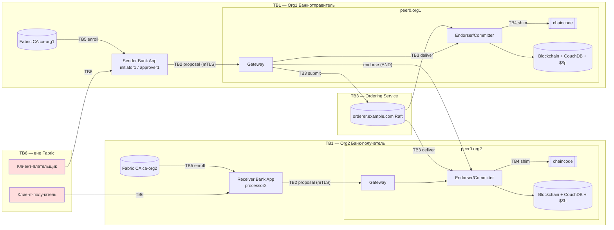

# Модель угроз — сеть платёжных поручений на Hyperledger Fabric (Вариант 1)

Методика: STRIDE по компонентам и доверительным границам, оценка риска DREAD (0–10 по пяти факторам, риск = среднее), привязка к OWASP Smart Contract Top 10 (2025) и к тестам.

## 1. Активы

| ID | Актив | Свойство безопасности |
|---|---|---|
| A1 | Состояние `PaymentOrder` (статус, сумма, валюта, стороны) | целостность, неотказуемость |
| A2 | Расчётные реквизиты (IBAN, BIC, БИН/ИИН, наименование получателя) | конфиденциальность |
| A3 | Закрытые ключи MSP и TLS (peer, orderer, admin, пользователи) | конфиденциальность |
| A4 | Корневые ключи и БД Fabric CA (ca-org1, ca-org2, ca-orderer) | конфиденциальность, целостность |
| A5 | Определение chaincode и Endorsement Policy (`_lifecycle`) | целостность |
| A6 | Конфигурация канала `paymentchannel` (MSP, политики, capabilities) | целостность |
| A7 | Ключи consenter-ов Ordering Service | конфиденциальность |
| A8 | Целостность Blockchain (хэш-цепочка блоков) | целостность |
| A9 | Доступность сервиса платежей (peers, orderer, CouchDB) | доступность |

## 2. Участники

| Участник | Org / MSP | Доверие |
|---|---|---|
| initiator1 — операционист отправителя | Org1MSP, role=initiator | доверенный в пределах роли |
| approver1 — контролёр отправителя | Org1MSP, role=approver | доверенный в пределах роли |
| processor2 — операционист получателя | Org2MSP, role=processor | доверенный в пределах роли |
| Администраторы Org1 / Org2 / Orderer | Admin@orgN, Admin@example.com | привилегированные |
| Администратор CA | bootstrap-идентичность CA | привилегированный |
| Внешний атакующий | — | недоверенный, вне сети (TB6/TB2) |
| Злонамеренный инсайдер Org2 | Org2MSP с валидным сертификатом | частично доверенный — **главный сценарий Задания 2** |
| Скомпрометированный peer | любой peer | недоверенный узел внутри сети |
| Скомпрометированный orderer | OrdererMSP | недоверенный (Raft — CFT, не защищает от злонамеренного лидера) |

## 3. Доверительные границы (лист 1 `docs/architecture/architecture_variant1.drawio`)

TB1 — граница организации; TB2 — Client ↔ Peer/Gateway (mTLS + подпись X.509); TB3 — организации ↔ Ordering Service; TB4 — Peer ↔ контейнер chaincode; TB5 — Fabric CA ↔ участники; TB6 — внешние клиенты банков ↔ Client Application.

## 4. STRIDE + DREAD

DREAD: D — ущерб, R — воспроизводимость, E — сложность эксплуатации (10 = легко), A — затронутые пользователи, Dis — обнаруживаемость. Риск = среднее. Меры: **[Р]** реализовано, **[П]** процедурно, **[Рек]** рекомендовано.

| ID | Компонент | Граница | STRIDE | Сценарий (банковские платежи) | OWASP SC | Вер. | Влияние | D/R/E/A/Dis → риск | Меры защиты | Остаточный риск | Тест |
|---|---|---|---|---|---|---|---|---|---|---|---|
| T-01 | Chaincode | TB1/TB4 | **E** Elevation of Privilege | Инсайдер Org2 вызывает `SubmitPaymentOrder` и авторизует списание чужого поручения, затем Accept/Settle — платёж проведён одной стороной (**воспроизведено на `paymentvuln`**) | SC01, SC03 | высокая | критическое | 10/10/9/8/7 → **8.8** | [Р] проверка MSP = senderBankMSP, роль approver, INV-4/INV-SoD в `paymentsecure` | низкий | SEC-04, `21_exploit.log`, `25_exploit_secure.log` |
| T-02 | Chaincode | TB4 | **T** Tampering | Недопустимый переход (Settle из SUBMITTED, повторный Settle), изменение суммы после авторизации | SC03 | средняя | высокое | 9/9/7/6/6 → **7.4** | [Р] таблица переходов, терминальные статусы, неизменяемость полей INV-3/7/8 | низкий | SEC-07, SEC-08, N1 |
| T-03 | Chaincode | TB2/TB4 | **T** Tampering | Некорректные входные данные: сумма `-1`, `1e3`, `2^63`, неизвестная валюта, IBAN с ошибкой контрольной суммы, огромный transient | SC04, SC08, SC10 | высокая | высокое | 8/10/9/6/8 → **8.2** | [Р] строгая валидация, ParseInt + MaxAmount, IBAN mod-97, лимит 4 КБ, DisallowUnknownFields | низкий | SEC-10, SEC-11, unit-тесты |
| T-04 | Chaincode / Peer | TB2/TB4 | **I** Information Disclosure | Реквизиты передаются в той же транзакции, что и публичная запись с AND-политикой → transient уходит на peer Org2 при endorsement | SC01 | высокая (при наивном дизайне) | высокое | 8/10/8/7/3 → **7.2** | [Р] отдельная транзакция `SetSettlementDetails`, collection EP `OR('Org1MSP.peer')`, endorse только peer0.org1, отказ на чужом peer | низкий | SEC-17, `23_private_flow.log` |
| T-05 | Ledger | TB3 | **I** Information Disclosure | Хэш реквизитов виден всем участникам и orderer; перебор низкоэнтропийных значений (БИН — 12 цифр, IBAN проверяем) | SC09 (аналог) | средняя | высокое | 7/8/5/6/4 → **6.0** | [Р] соль ≥ 32 hex, генерируется клиентом; канонический JSON | низкий | SEC-13 (неверная соль → false), unit-тесты |
| T-06 | Peer / Ledger | TB1 | **I** Information Disclosure | Чтение `privateDetails` пользователем Org2 через свой или чужой peer; утечка в CouchDB Org2 / логах контейнеров | SC01 | средняя | высокое | 8/9/7/5/5 → **6.8** | [Р] `memberOnlyRead`, MSP клиента = MSP peer, policy `OR('Org1MSP.member')`; chaincode не логирует данные | низкий | SEC-02, SEC-03, SEC-15 |
| T-07 | Client | TB6/TB2 | **S** Spoofing | Кража закрытого ключа initiator1 с рабочей станции → создание поручений от имени сотрудника | — (инфраструктура) | средняя | высокое | 8/5/6/5/4 → **5.6** | [П] ключи в HSM/PKCS#11, ротация; [Р] роль + четыре глаза ограничивают ущерб: один ключ не позволяет авторизовать списание | средний | SEC-05 |
| T-08 | Client | TB6 | **R** Repudiation | Сотрудник отрицает, что авторизовал платёж | SC01 | низкая | среднее | 6/6/4/4/6 → **5.2** | [Р] подпись X.509 каждой транзакции, `approvedByHash`/`createdByHash`, `GetPaymentOrderHistory` с TxID, TxID = SHA-256(nonce‖creator) | низкий | T4 anatomy, `GetPaymentOrderHistory` |
| T-09 | Gateway | TB2 | **D** Denial of Service | Массовые `GetAllPaymentOrders` без лимита, большие payload, медленные клиенты | SC10 | средняя | среднее | 5/9/8/7/8 → **7.4** | [Р] pageSize 1..50, лимит transient; [П] rate-limit на API-шлюзе банка, таймауты Gateway | средний | SEC-14 |
| T-10 | Gateway | TB2 | **S** Spoofing | Подключение к Gateway без валидного TLS / с поддельным peer endpoint (MITM) | — | низкая | высокое | 7/4/3/6/5 → **5.0** | [Р] TLS с корнем CA организации, проверка server name (`payment-client`) ; [Рек] mTLS client auth на peers | низкий | `payment-client` (TLS) |
| T-11 | Ordering Service | TB3 | **T/D** Tampering / DoS | Злонамеренный или скомпрометированный orderer (Raft-лидер) цензурирует, переупорядочивает или задерживает транзакции; единственный orderer — точка отказа | — | низкая | высокое | 8/3/3/9/5 → **5.6** | [П] несколько организаций-orderer; [Рек] SmartBFT (Задание 3.7), мониторинг высот | средний | `evidence/task3/bft/` |
| T-12 | MSP / Fabric CA | TB5 | **S/E** Spoofing / Elevation | Компрометация CA или выпуск сертификата с `role=approver` посторонним; утечка enrollment secret | — | низкая | критическое | 10/3/3/9/3 → **5.6** | [Р] случайные секреты в `.secrets` (600), ротация после инцидента (`20b_rotate_secrets.sh`), атрибуты только `:ecert`; [П] офлайн-корень, CRL, MFA для администраторов CA | средний | `20_register_users.log` |
| T-13 | Ledger | TB1 | **T** Tampering | Изменение блока или CouchDB на диске одного peer | — | низкая | высокое | 8/2/2/5/7 → **4.8** | [Р] хэш-цепочка блоков (проверена `13_ledger_info.sh`), подписи orderer; CouchDB — производная, пересобирается из блоков | низкий | `13_ledger_info.log` |
| T-14 | Peer / Chaincode | TB4 | **D** DoS / **T** | Недетерминизм chaincode (`time.Now`, rand, порядок map) → разные RW-set на endorsers, транзакции не собирают AND | SC09 | низкая | среднее | 6/8/4/8/7 → **6.6** | [Р] `GetTxTimestamp`, `check_determinism.sh` = 0 находок | низкий | `07_static_analysis.log` |
| T-15 | Ledger / Peer | TB4 | **T** Tampering (race) | Двойная обработка одного поручения параллельными транзакциями | SC03, SC05 (аналог) | средняя | высокое | 8/7/6/5/7 → **6.6** | [Р] MVCC-валидация Fabric — вторая транзакция `MVCC_READ_CONFLICT` | низкий | M1/M2 (`10b_mvcc_demo.log`) |

Покрытие: компоненты Client (T-07, T-08), Gateway (T-09, T-10), Peer (T-04, T-06, T-14), Chaincode (T-01…T-04), Ordering Service (T-11), MSP (T-12), Ledger (T-05, T-13, T-15); категории STRIDE: S (T-07, T-10, T-12), T (T-02, T-03, T-11, T-13, T-15), R (T-08), I (T-04, T-05, T-06), D (T-09, T-11, T-14), E (T-01, T-12).

## 5. PASTA

Данный анализ соответствует этапам 4–6 PASTA (Process for Attack Simulation and Threat Analysis): **этап 4** — анализ угроз (STRIDE по DFD с доверительными границами), **этап 5** — анализ уязвимостей (OWASP SC Top 10, статический анализ, unit-тесты), **этап 6** — моделирование атак (практическое воспроизведение T-01 на `paymentvuln` от имени Org2 и проверка исправления на `paymentsecure`). Этапы 1–3 (бизнес-цели, технический контекст, декомпозиция приложения) отражены в спецификации chaincode и архитектурной схеме; этап 7 (анализ риска и воздействия) — в колонках DREAD и остаточного риска.
