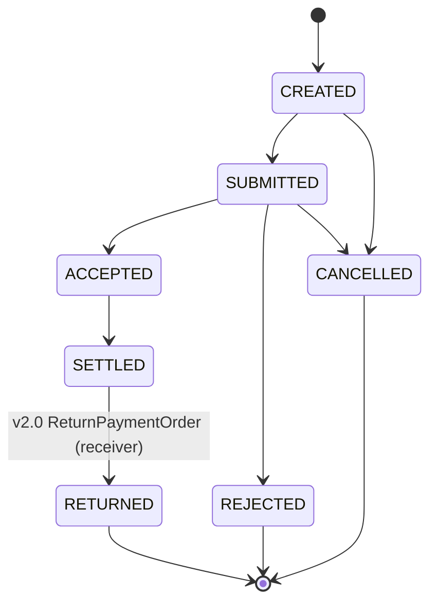

# `payment` 2.0 — совместимость с World State версии 1.0

`chaincode/payment-v2` — эволюция `payment-v1` (обновляется основной chaincode, имя `payment`, тот же namespace).

## Правила совместимости

| # | Правило | Обоснование | Как проверено |
|---|---|---|---|
| 1 | Формат ключей не меняется (`PO-...`, без composite keys) | World State принадлежит namespace `payment`; новые ключи сделали бы объекты v1.0 «невидимыми» для новой логики | C1, C2 — объекты читаются по старым ключам |
| 2 | JSON-поля v1.0 не переименовываются, не удаляются, не меняют тип (`amount` — `int64` в тиынах) | `json.Unmarshal` молча обнулит поле с другим именем/типом → потеря данных при первой записи | `TestGoldenV1ObjectsAreReadUnchanged` (JSONEq с реальным JSON v1), `TestLazyMigrationOnFirstWrite` (поля v1 после записи совпадают по значению и типу) |
| 3 | Новые поля только с `omitempty` (+ `metadata:",optional"` для contractapi) и безопасным нулевым значением | старые документы не содержат новых полей; схема ответа contractapi не должна требовать их | C1: ответ v2.0 для PO-0001 побайтно равен снимку v1 |
| 4 | Ленивая миграция: объект без `schemaVersion` читается как версия 1; первая запись через v2.0 ставит `schemaVersion: 2`. Массовой миграции в `Init` нет, `--init-required` не включается | массовая миграция = одна огромная транзакция (SC10) и изменение определения (init-required); ленивая миграция не трогает данные до их естественного изменения | C2 (sha256 состояния до первой записи совпал), C3 (`schemaVersion: 2` после Submit), C8 (в истории записи без и со `schemaVersion`) |
| 5 | Существующие статусы и переходы сохраняются, новые только добавляются (`SETTLED → RETURNED`) | старые клиенты и процессы не ломаются | все 70 unit-тестов v1.0 проходят на v2.0 **без изменений** (файлы тестов побайтно идентичны) |
| 6 | Сигнатуры и семантика функций v1.0 не меняются (`CreatePaymentOrder` по-прежнему 6 аргументов; дата валютирования — отдельной функцией `SetValueDate`) | старые клиенты (`payment-client`, скрипты) продолжают работать | C3, C7 — старые вызовы через v2.0 |

## Новая функциональность

| Функция | Тип | Кто | Переход / действие |
|---|---|---|---|
| `ReturnPaymentOrder(id, reasonCode)` | submit | receiverBankMSP | SETTLED → **RETURNED** (терминальный, не более одного раза) |
| `SetValueDate(id, date)` | submit | senderBankMSP | только CREATED; `YYYY-MM-DD`, не раньше даты создания |
| `GetPaymentOrdersByStatus(status, pageSize, bookmark)` | evaluate | члены канала | rich query CouchDB по индексу `META-INF/statedb/couchdb/indexes/indexStatus.json` (`docType`, `status`), `pageSize` 1..50 |

Новые поля: `schemaVersion` (int), `valueDate`, `returnReason`, `returnedAt` — все `omitempty`.

## Почему данные сохраняются

World State принадлежит **namespace chaincode** (имени `payment` в канале), а не пакету. Commit нового определения (sequence 2) меняет только то, какой пакет исполняется для этого namespace; ключи и значения в CouchDB (`paymentchannel_payment`) остаются на месте. Обязанность новой реализации — уметь их читать (правила 1–6).

## Тесты

`chaincode/payment-v2/chaincode/`: регрессия v1.0 (`contract_test.go`, `contractapi_test.go`, `harness_test.go` — копии без изменений), golden-фикстуры `testdata/v1_PO-0001.json`, `v1_PO-0003.json` (реальный JSON, возвращённый `payment` 1.0 в сети, сохранён `scripts/30_pre_upgrade_snapshot.sh`), ленивая миграция, новые функции, негативные случаи. Итог: 76 тестов, покрытие 96.5 %, `go vet` / `staticcheck` / `gosec` / `govulncheck` / `check_determinism.sh` — чисто (`evidence/task3/32_static_analysis_payment_v2.log`).
